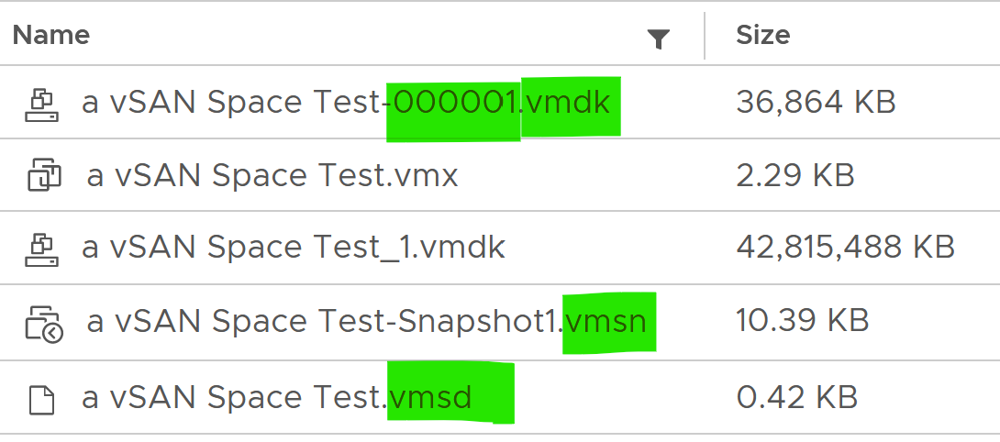
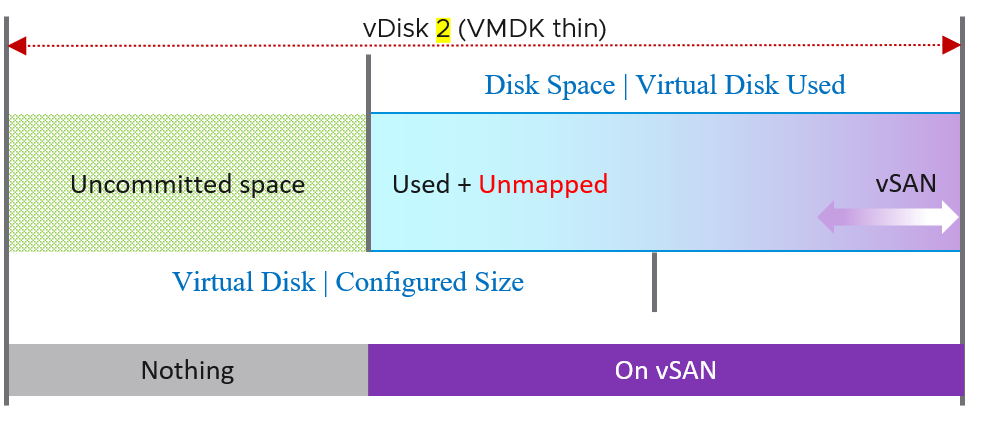
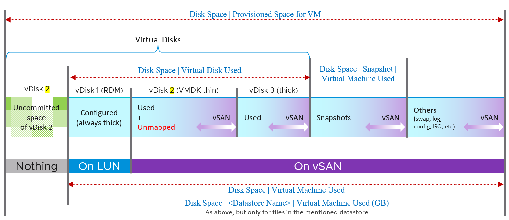

# VM files and disk space

## Space components of a virtual disk
- Used by the Guest OS.
- Unmapped blocks (freed in the guest, still allocated).
- vSAN protection (FTT).
- vSAN savings (deduplication, compression).

## File categories
| Category | Files | Facts |
|---|---|---|
| Disk | Virtual disk or RDM pointer | Typically the largest. Thin disks are usually smaller than provisioned: guest filesystems rarely fill 100%. |
| Disk | MyVM1.vmdk (descriptor), MyVM1-flat.vmdk (data) | The descriptor holds size, geometry, adapter type and a pointer to the data file. |
| Snapshot | MyVM-000001.vmdk per VMDK | One per VMDK per snapshot. Six-digit sequence number. |
| Snapshot | .vmem | Memory image, when the snapshot includes memory. |
| Snapshot | .vmsn | VM configuration. |
| Snapshot | .vmsd | Metadata of all active snapshots. One file, under 1 KB, updated on each snapshot create or delete. |
| Swap | .vswp | Size = configured RAM - memory reservation. Deleted at power-off. |
| Swap | VMX swap file | Small (MB). The book has not observed it. |
| Others | Logs, .vmx, .nvram | Small (KB or MB). Any file placed in the VM folder counts, for example an ISO. A large value means unneeded files. |



- A snapshot protects VMDK, memory and configuration.
- Snapshots do not apply to RDM. RDM snapshots happen in the storage system, transparent to ESXi.
- A VM can have up to 64 disks, across datastores.
- Storing .vswp on local host storage saves vSAN space. Trade-off: vMotion must copy the swap file.

## Single thin VMDK on vSAN

- Unmapped blocks are also protected by vSAN.
- Uncommitted space (room to grow) has no vSAN overhead: not yet written.
- Virtual Disk Used and Configured Size are not aware of vSAN.

## Thin, thick and RDM in one VM


| Disk | Facts |
|---|---|
| RDM | Not on vSAN or VMFS data: mapped to an external LUN. Always counts as thick (configured size), whatever the guest uses. A thin LUN on the array is transparent to ESXi. |
| Thin VMDK | One file holds data + vSAN protection - dedupe - compression. Accumulates unmapped blocks: reclaim with trim/unmap. |
| Thick VMDK | Used = configured size, whatever the guest uses. |

- vSAN protection applies to every file on the datastore, including snapshots and logs.

## vSphere Client: Used vs Allocated
- New VM, 10 GB thin disk on vSAN, powered off: Used 1.9 KB; Allocated 12.22 GB (10 GB configured + 2.22 GB).
- Files in the folder totalled 36 MB. Neither number is explained by them.
- Added a 20 GB thick disk on vSAN: Used 760 MB (380 MB data + 380 MB vSAN protection, no dedupe or compression). Allocated 32.93 GB (30 GB configured + 2.93 GB overhead including vSAN protection). The datastore shows 40.86 GB for that disk.
- Allocated contains used plus potential future use up to configured size. Only the used part includes vSAN overhead.

## Traps
- "Thick disk Used = guest usage" → it is the configured size.
- "Snapshots apply to RDM" → no; the array handles it.
- "Hard disk size in the UI includes vSAN" → it shows configured size, the guest view.

## Metadata
```yaml
id: vsphere/technology/storage/concepts/vm-files
retriever_guide: how-it-works
scope: vsphere
technology:
- storage
pillar:
- capacity
- cost
product:
- vsphere
- vsan
object:
- VirtualMachine
- Datastore
internal_derive: []
related:
- vsphere/technology/storage/concepts/snapshot-impact
- vsphere/technology/storage/metrics/virtual-motherboard/disk-space-virtual-disk-used
- vsphere/technology/storage/metrics/virtual-motherboard/disk-space-used
- vsphere/technology/storage/metrics/virtual-motherboard/disk-space-provisioned
- vsphere/technology/storage/metrics/virtual-motherboard/disk-space-snapshot
images:
  - path: ../images/vm-snapshot-files.png
    product: [vsphere]
    object: [VirtualMachine, Datastore]
    topic: 'VM snapshot'
    image_type: screenshot
  - path: ../images/vsan-thin-vmdk-space-used-unmapped-uncommitted-protection.png
    product: [vsan]
    object: [VirtualMachine, Datastore]
    topic: 'VM disk space'
    image_type: diagram
  - path: ../images/vm-disk-consumption-thin-vs-thick-vs-rdm.png
    product: [vsphere]
    object: [VirtualMachine, Datastore]
    topic: 'VM disk space'
    image_type: diagram
source:
  document: PART 3 - Counters.docx
  path: Storage > VM > Capacity Metrics > VM Files; Single VMDK; All VM Files; vSphere Client UI
corrections: []
review_notes: []
status: draft
```
