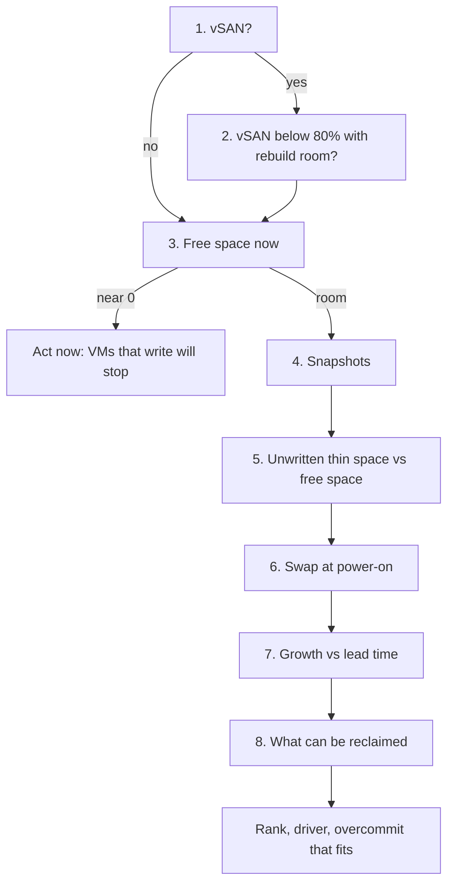

# Will this datastore run out of space?

## Question
- Will this datastore run out of space before it can be expanded or reclaimed, and how far can its thin disks be overcommitted?
- The answer is a rank (act now, watch, fine), with the part of the used and provisioned space that drives it, and the reason.
- An operational question, answered by a decision tree; not a health check. Space is availability, not performance: on SSD storage a full datastore is not slower, it stops (`vsphere/technology/storage/concepts/storage-dimensions`).

## Flow


## Checks, in order
1. Datastore type (Datastore). vSAN → step 2. VMFS or NFS → step 3. On an array with thin LUNs (thin on thin), read the array's free space too: the datastore can show room the array no longer has.
2. vSAN capacity (Datastore). Used space includes the copies the storage policy keeps: FTT that doubles space doubles used. Keep consumption below 80%: above it vSAN rebalances, and it needs room to rebuild after a host failure or maintenance (`vsphere/object-types/cluster/decision-tree/can-cluster-take-a-host-out`, step 6). Above 80% → act now. → step 3.
3. Free space now (Datastore): capacity − used. A datastore is full when used equals capacity. Then a VM whose thin disk or snapshot must grow cannot write; applications fail. Near 0 → act now: reclaim (step 8) or expand. Otherwise → step 4.
4. Snapshots (VirtualMachine): VM Disk Space | Snapshot (`vsphere/technology/storage/metrics/virtual-motherboard/disk-space-snapshot`). A delta grows with every write to the disk under it. A snapshot kept beyond its change window is both a space risk and a performance cost (`vsphere/technology/storage/concepts/snapshot-impact`). Large or old snapshots → remove after the change is validated. → step 5.
5. Thin disks (Datastore). Provisioned − used is space the thin disks can still claim: a reservation in effect (`sp5-framework/capacity/demand`, section Demand). Provisioned ÷ capacity is the overcommit ratio of the datastore; count virtual disks only, not snapshots or swap (`sp5-framework/capacity/overcommit`). Unwritten thin space larger than free space → the datastore can fill with no new VM added: rank it high. → step 6.
6. Swap at power-on (VirtualMachine). Each VM creates a .vswp of configured memory − memory reservation at power-on, and deletes it at power-off (`vsphere/technology/storage/concepts/vm-files`). Powered-off VMs need that space to start; an HA restart or a DR test powers many on at once. → step 7.
7. Growth (Datastore). Used space trend against the lead time to expand or reclaim (`sp5-framework/capacity/forecasting`). Reality overrides the projection: a burst of writes or a new snapshot fills a datastore faster than any trend. → step 8.
8. Reclaimable (Datastore, VirtualMachine). Unmapped blocks of thin disks (TRIM and unmap), orphaned VMDKs, powered-off VMs (space returns only when deleted), ISO files and templates (`sp5-framework/capacity/reclamation`). → answer.

## Why this order
- vSAN first: its used space and its reserve follow different rules from VMFS and NFS.
- Free space now before anything else: a full datastore is an outage in progress.
- Snapshots before thin disks: they grow fastest and are the easiest to remove.
- Thin disks before growth: unwritten thin space can fill a datastore with no trend in the history.
- Reclaim last: what can be freed decides whether to reclaim or expand.

## How to read the result
- Act now: free space near 0, or vSAN above 80%. Reclaim the easiest space first (snapshots, unmap), then expand.
- Watch: unwritten thin space larger than free space, large snapshots, or growth that fills the datastore before an expansion can arrive.
- Fine: free space covers the unwritten thin space, the snapshots and the swap of the powered-off VMs.
- Overcommit that fits: provisioned ÷ capacity at which the unwritten thin space that can grow before the next reclaim or expansion still fits in free space. There is no ratio that fits every datastore: it depends on how fast the thin disks fill.

## Misconceptions
- "Used is 60%, so the datastore is safe" → thin disks can claim their unwritten space at any time; compare provisioned − used with free space.
- "A 95% full datastore is slow" → space does not change speed on SSD; it threatens availability.
- "Powering off a VM frees its datastore space" → it frees only its swap file; the disks stay until the VM is deleted.
- "Snapshots are small" → a delta grows with every write to the disk under it.
- "Projection says 90 days left" → a snapshot or a write burst can fill it first; 0 bytes left overrides any projection.
- "vSAN used space is the VM data" → it includes the copies of the storage policy.

## Metadata
```yaml
id: vsphere/technology/storage/decision-tree/datastore-space-headroom
retriever_guide: decision-tree
scope: vsphere
technology:
- storage
pillar:
- capacity
- availability
product:
- vsphere
- vsan
- vcf-operations
object:
- Datastore
- VirtualMachine
internal_derive:
- vsphere/technology/storage/concepts/storage-dimensions
- vsphere/technology/storage/metrics/virtual-motherboard/disk-space-provisioned
- vsphere/technology/storage/metrics/virtual-motherboard/disk-space-snapshot
- vsphere/technology/storage/concepts/snapshot-impact
- vsphere/technology/storage/concepts/vm-files
- sp5-framework/capacity/overcommit
- sp5-framework/capacity/reclamation
related:
- sp5-framework/capacity/forecasting
- sp5-framework/capacity/demand
- vsphere/object-types/cluster/decision-tree/can-cluster-take-a-host-out
- vsphere/technology/storage/metrics/host/datastore
source:
  document: Knowledge base synthesis of the files in internal_derive; vSAN 80% from VCF 9.1.x documentation (TechDocs), Planning Capacity in vSAN (updated 2026-11-05)
  path: https://techdocs.broadcom.com/us/en/vmware-cis/vcf/vcf-9-0-and-later/9-1/vsan-deployment-administration-and-monitoring/vsan-planning-and-deployment/designing-and-sizing-a-virtual-san-cluster/sizing-a-virtual-san-datastore/planning-capacity-in-virtual-san.html
corrections: []
review_notes:
- 'To check: Step 3: what a VM does when its datastore is full (paused with a question, or IO errors in the guest); no 9.1 page read states it.'
status: draft
```
