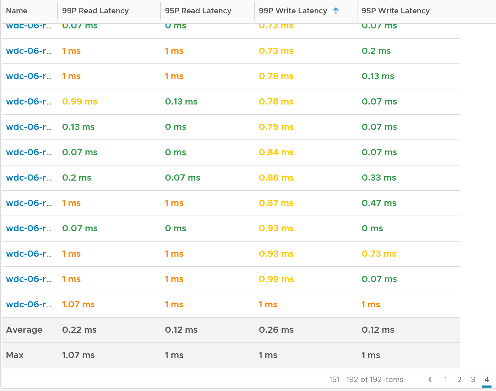
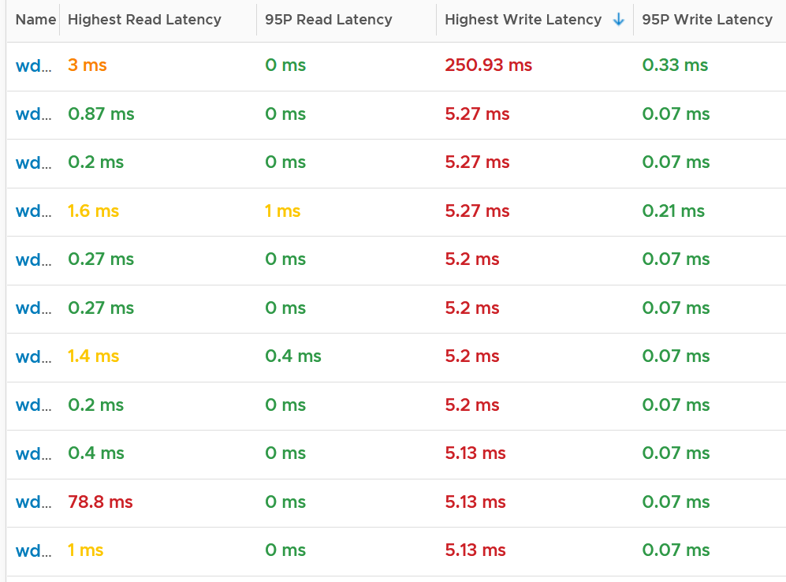

# ESXi Storage adapter and storage path metrics

## Scope
- Adapter and path have identical counter sets.
- Path object names are not friendly names: they can look like devices, but the object is the path.
- No adapter queue length or commands aborted: the book would like both.

## Contention counters
- Read latency, write latency, highest latency.
- Highest latency takes the worst adapter or path, but averages read and write per adapter first. So it can be lower than the worst read latency. The useful value is the highest read or write among all adapters or paths.

## Consumption counters
- Read IOPS, write IOPS, read throughput, write throughput.
- Block size: derive with a super metric (throughput / IOPS).

## Example: 192 hosts
- Worst write latency in a week: 250 ms on one host, while its 95th percentile was 0.33 ms: a one-off.
- The other 191 hosts: maximum 5 ms.
- Using the 99th percentile instead of the maximum still revealed hosts with real latency problems. Drill down per adapter.



## Traps
- "Highest latency = worst read or write" → it averages read and write per adapter first.
- "Maximum shows the problem hosts" → one outlier dominates. Use the 95th or 99th percentile.

## Metadata
```yaml
id: vsphere/technology/storage/metrics/host/adapter-and-path
retriever_guide: metric-meaning
scope: vsphere
technology:
- storage
pillar:
- performance
product:
- vsphere
object:
- HostSystem
metric_class: contention
internal_derive: []
same_name: []
same_meaning: []
related:
- vsphere/technology/storage/metrics/host/disk
- vsphere/technology/storage/troubleshooting/host-storage-latency
images:
  - path: ../../images/esxi-storage-adapter-latency-99th-vs-95th-percentile-sorted.png
    product: [vcf-operations]
    object: [HostSystem]
    metric: ['ESXi Storage Adapter Read Latency', 'ESXi Storage Adapter Write Latency']
    image_type: table
    sample: '192 hosts'
  - path: ../../images/esxi-storage-adapter-read-write-latency-worst-vs-average-across-hosts.png
    product: [vcf-operations]
    object: [HostSystem]
    metric: ['ESXi Storage Adapter Read Latency', 'ESXi Storage Adapter Write Latency']
    image_type: table
    sample: '192 hosts, 1 week'
source:
  document: PART 3 - Counters.docx
  path: Storage > ESXi > Storage Adapter & Path
corrections: []
review_notes: []
status: draft
```
