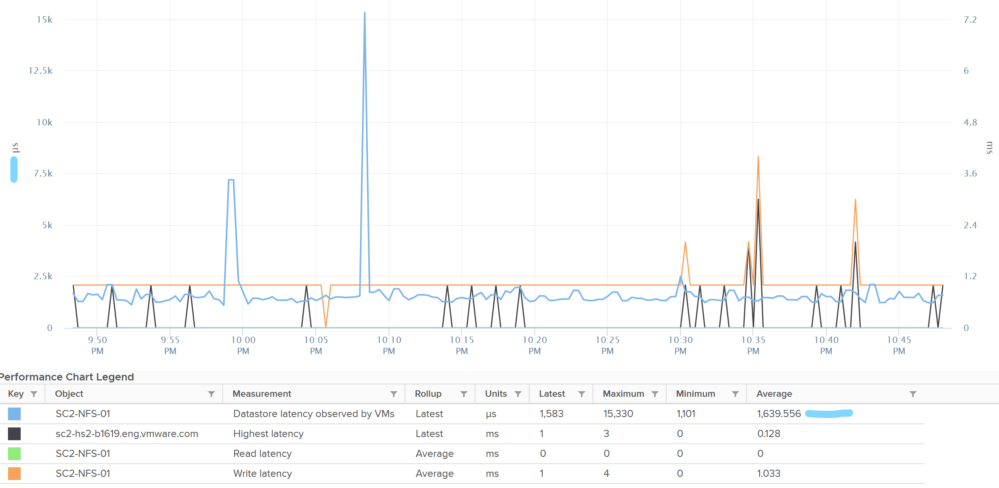

# ESXi Datastore metrics (host view)

## Scope
- This host's view only. For a shared datastore, values differ from the datastore object, which spans all hosts.
- Performance, plus unmap activity (space reclamation). Capacity is covered at the datastore object.
- Relevance for operations: performance troubleshooting (this host's share of a datastore's IO and latency; Maximum Queue Depth against the design) and capacity (Unmap IO and Unmap Size show that space reclamation works). The view across all hosts of a shared datastore is not here.

## Counters
- IOPS, throughput and latency, each read and write: 6 counters.
- Block size: derive as throughput / IOPS.
- Datastore latency observed by VMs: much higher than the datastore latency in one observed example. The VMkernel queues sit between the two readings ([`vsphere/technology/storage/concepts/esxi-storage-io-path`](../../concepts/esxi-storage-io-path.md), section Queues on the path); the example did not measure them.
- Highest latency: a normalized average of read and write, so it can be lower.
- Outstanding IO: derive from latency and IOPS. Latency is more insightful: little IO in the queue can still mean high latency.
- Queue depth per datastore (likely the backing LUN). Check settings are as expected and consistent; list them per cluster.
- Maximum Queue Depth (maxQueueDepth): commands the SCSI driver queues to the HBA for this datastore.
- With Storage I/O Control enabled, Maximum Queue Depth changes over time when congestion is detected at the array. A drop is throttling, not a configuration change. See [`vsphere/technology/storage/metrics/datastore/storage-io-control`](../datastore/storage-io-control.md).


## Unmap
- Two metrics on the ESXi host, one instance per datastore:
  - Unmap IO: number of unmap commands the host sent to the datastore. Like IOPS, but each command asks the array to release blocks; no data is read or written.
  - Unmap Size (MB): space released by those commands.
- VCF Operations: the 20-second values are summed per 20 seconds, then averaged over the 5-minute cycle.
- Per host and datastore only: a datastore total across hosts is not available. Sum the hosts that mount it.
- Unmap starts from two places: the VMFS datastore (deleted or migrated VMs, consolidated snapshots) and the Guest OS (files deleted on a thin virtual disk).
- VMFS6 sends unmap automatically, in the background, at a constant rate. Default priority Low: 25-50 MB/s; Medium 50-100 MB/s; High above 100 MB/s; None deactivates it. The vSphere Client offers only Low and None; Medium and High need esxcli. Granularity equals the VMFS block size (1 MB): free regions smaller than that are not reclaimed.
- Fixed method: a set rate instead of a priority, at least 10 MB/s (`esxcli storage vmfs reclaim config set -l <datastore> -m fixed -b <MB/s>`); `esxcli storage vmfs reclaim config get -l <datastore>` shows the current setting.
- VMFS frees the space at once; the array frees its blocks only as the throttled unmap reaches it, so array free space lags (Broadcom KB 452963). To catch up at once: `esxcli storage vmfs unmap --volume-label=<datastore>`.
- A host sending unmap regularly is normal on thin-provisioned arrays. Unmap Size near 0 for weeks on a thin datastore with deletions: check that space reclamation is on, and that a file on the datastore is open. A VMFS6 datastore releases blocks only while at least one of its files is open, for example the files of a powered-on VM (vSphere 9.1 documentation, p. 1535).
- Space left to reclaim in a VM: compare Guest OS used space with virtual disk used space ([`sp5-framework/capacity/reclamation`](../../../../../sp5-framework/capacity/reclamation.md), section TRIM and unmap).

## Misconceptions
- "Host datastore IOPS = datastore total" → one host's share only.
- "Write latency high, read low is odd" → expected when reads are served by cache.
- "Unmap IO is IO load like reads and writes" → it moves no data; it releases blocks on the array.
- "Deleting files in the guest frees array space at once" → VMFS6 unmaps in the background at a set rate (Low: 25-50 MB/s), and regions under 1 MB are not reclaimed.

## Metadata
```yaml
id: vsphere/technology/storage/metrics/host/datastore
retriever_guide: metric-meaning
scope: vsphere
technology:
- storage
pillar:
- performance
- capacity
product:
- vsphere
- vcf-operations
object:
- HostSystem
metric_class: contention
internal_derive:
- vsphere/technology/storage/concepts/storage-layers
- vsphere/technology/storage/concepts/esxi-storage-latency-stack
- vsphere/architecture/object-relationships
same_name: []
same_meaning: []
related:
- vsphere/technology/storage/metrics/virtual-motherboard/datastore
- vsphere/technology/storage/metrics/host/disk
- vsphere/technology/storage/metrics/datastore/storage-io-control
- sp5-framework/capacity/reclamation
images:
  - path: ../../images/datastore-latency-vs-latency-observed-by-vms.png
    product: [vsphere]
    object: [Datastore, VirtualMachine]
    metric: ['Datastore Latency', 'VM Disk Latency']
    image_type: timeline
source:
  document: Knowledge base; VMware vSphere 9.1 product documentation (PDF built 2026-11-02; the copyright page carries no revision number)
  path: Storage > ESXi > Datastore; Capacity Management > Reclamation > TRIM and Unmap; vSphere Monitoring and Performance > Datastores and Datastore Clusters > Maximum Queue Depth per Host (p. 2051); vSphere Storage > Storage Space Reclamation in vSphere (pp. 1535-1537)
corrections: []
review_notes:
- 'To check: Section ''Counters'': the gap between Datastore latency observed by VMs and datastore latency, layer by layer (QAVG and KAVG of the same host and period); see also vsphere/technology/storage/metrics/datastore/storage-io-control, section Includes / excludes.'
- 'To check: Section ''Unmap'': the vCenter counter keys (likely datastore.unmapIOs and datastore.unmapSize, summation) and the datastore total as the sum of the hosts that mount it; open question Q-E2-124; vSphere 9.1 API reference, https://developer.broadcom.com/xapis/vsphere-web-services-api/9.1/.'
status: draft
```
