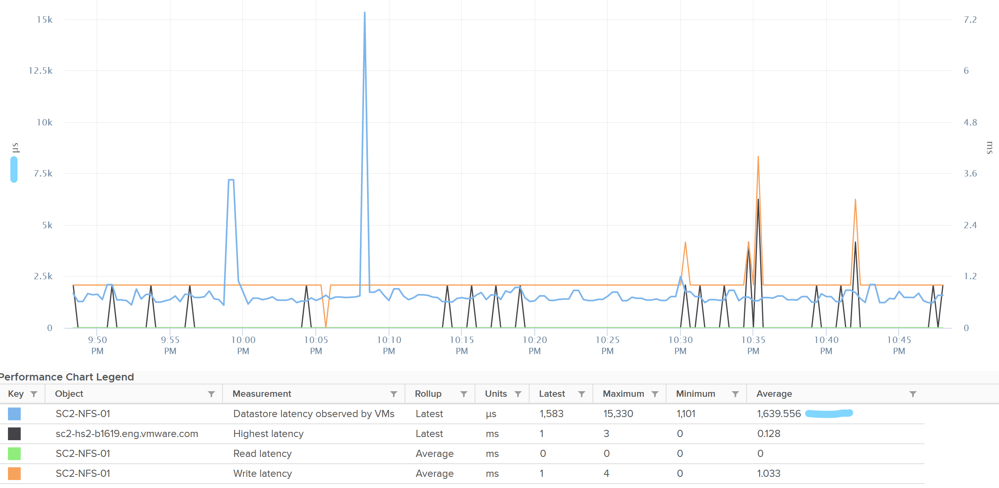

# ESXi Datastore metrics (host view)

## Scope
- This host's view only. For a shared datastore, values differ from the datastore object, which spans all hosts.
- Performance, plus unmap activity (space reclamation). Capacity is covered at the datastore object.

## Counters
- IOPS, throughput and latency, each read and write: 6 counters.
- Block size: derive as throughput / IOPS.
- Datastore latency observed by VMs: much higher than the datastore latency in the book's example. Only the kernel sits between them; the gap is unexplained.
- Highest latency: a normalized average of read and write, so it can be lower.
- Outstanding IO: derive from latency and IOPS. Latency is more insightful: little IO in the queue can still mean high latency.
- Queue depth per datastore (likely the backing LUN). Check settings are as expected and consistent; list them per cluster.
- Maximum Queue Depth (maxQueueDepth): commands the SCSI driver queues to the HBA for this datastore.
- With Storage I/O Control enabled, Maximum Queue Depth changes over time when congestion is detected at the array. A drop is throttling, not a configuration change. See `vsphere/technology/storage/metrics/datastore/storage-io-control`.


## Unmap
- Two metrics on the ESXi host, one instance per datastore:
  - Unmap IO: number of unmap commands the host sent to the datastore. Like IOPS, but each command asks the array to release blocks; no data is read or written.
  - Unmap Size (MB): space released by those commands.
- VCF Operations: the 20-second values are summed per 20 seconds, then averaged over the 5-minute cycle.
- Per host and datastore only: a datastore total across hosts is not available. Sum the hosts that mount it.
- Unmap starts from two places: the VMFS datastore (deleted or migrated VMs, consolidated snapshots) and the Guest OS (files deleted on a thin virtual disk).
- VMFS6 sends unmap automatically, in the background, at a constant rate. Default priority Low: 25-50 MB/s; Medium 50-100 MB/s; High above 100 MB/s; None deactivates it. Granularity equals the VMFS block size (1 MB): free regions smaller than that are not reclaimed.
- A host sending unmap regularly is normal on thin-provisioned arrays. Unmap Size near 0 for weeks on a thin datastore with deletions: check that space reclamation is on.
- Space left to reclaim in a VM: compare Guest OS used space with virtual disk used space (`sp5-framework/capacity/reclamation`, section TRIM and unmap).

## Misconceptions
- "Host datastore IOPS = datastore total" → one host's share only.
- "Write latency high, read low is odd" → expected when reads are served by cache.
- "Unmap IO is IO load like reads and writes" → it moves no data; it releases blocks on the array.
- "Deleting files in the guest frees array space at once" → VMFS6 unmaps in the background at a set rate (Low: 25-50 MB/s), and regions under 1 MB are not reclaimed.

## Metadata
```yaml
id: vsphere/technology/storage/metrics/host/datastore
retriever_guide: metric-meaning
scope: vsphere
technology:
- storage
pillar:
- performance
- capacity
product:
- vsphere
- vcf-operations
object:
- HostSystem
metric_class: contention
internal_derive: []
same_name: []
same_meaning: []
related:
- vsphere/technology/storage/metrics/virtual-motherboard/datastore
- vsphere/technology/storage/metrics/host/disk
- vsphere/technology/storage/metrics/datastore/storage-io-control
- sp5-framework/capacity/reclamation
images:
  - path: ../../images/datastore-latency-vs-latency-observed-by-vms.png
    product: [vsphere]
    object: [Datastore, VirtualMachine]
    metric: ['Datastore Latency', 'VM Disk Latency']
    image_type: timeline
source:
  document: PART 3 - Counters.docx
  path: Storage > ESXi > Datastore; PART 1 - Concepts of Operations Management.docx, Capacity Management > Reclamation > TRIM and Unmap (pp. 116-117)
corrections: []
review_notes:
- 'Section ''Counters'': the gap between Datastore latency observed by VMs and datastore latency is unexplained in the book.'
- 'Section ''Counters'': Maximum Queue Depth definition and its change under Storage I/O Control from the vSphere 9.1 documentation (vSphere Monitoring and Performance > Datastores and Datastore Clusters > Maximum Queue Depth per Host, p. 2050).'
- 'Section ''Unmap'': Unmap IO and Unmap Size from Part 1 (TRIM and Unmap). Automatic unmap on VMFS6, priority rates and 1 MB granularity from the vSphere 9.1 documentation (vSphere Storage > Storage Space Reclamation in vSphere, pp. 1533-1534).'
- 'To check: Section ''Unmap'': vCenter counter keys, likely datastore.unmapIOs and datastore.unmapSize (summation); add to the catalog after checking (vSphere 9.1 API reference).'
- 'To check: Section ''Unmap'': the check for Unmap Size near 0; not in the sources.'
- 'To check: Section ''Unmap'': "sum the hosts that mount it" as the reading of the book sentence "You can track both operations on each datastore, but you can''t aggregate them per datastore" (Q124).'
status: draft
```
