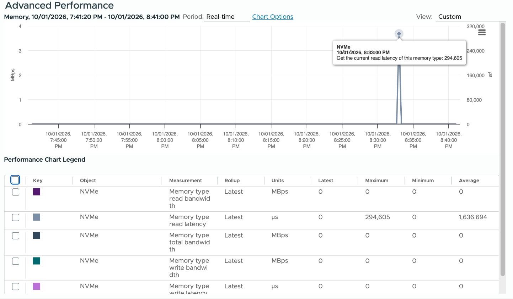

# ESXi Disk (device) metrics

## Scope
- One of 4 ESXi storage metric groups: Datastore, Disk, Storage adapter, Storage path.
- Disk = device (LUN). More metrics than adapter or path: includes capacity.
- No breakdown per VM.

## Contention counters
- Device, kernel, queue and guest latency, each as read, write and command. See `vsphere/technology/storage/concepts/esxi-storage-latency-stack`.
- Bus Resets and Commands Aborted: always 0 in the book's observation.
- Highest Latency: the book is unsure whether it is guest, kernel or device.
- Maximum Queue Depth: a setting, more property than metric.

## Consumption counters
| Group | Counters | Unit |
|---|---|---|
| Throughput | Read Rate, Write Rate, Usage | KB/s |
| Total IO | Read Requests, Write Requests, Commands Issued | Count in the interval |
| IOPS | Average read and write requests per second | /s |

## Memory tiering devices
- An NVMe device used for memory tiering can show very high latency at almost no activity.
- Tiering moves pages in 4 KB. One 4 KB read in a 20-second sample = 0.0002 MBps, shown as 0 MBps. The IO is not 0.
- An idle NVMe controller enters deep power states (PS3, PS4, ASPM L1.2). PS4 entry takes 5-10 seconds of idle.
- Waking to D0/PS0 adds 50-100 ms to the first IO.


## Misconceptions
- "High latency on an idle NVMe tier device is a problem" → wake-up penalty on sporadic IO.

## Metadata
```yaml
id: vsphere/technology/storage/metrics/host/disk
retriever_guide: metric-meaning
scope: vsphere
technology:
- storage
pillar:
- performance
product:
- vsphere
object:
- HostSystem
metric_class: contention
internal_derive: []
same_name: []
same_meaning: []
related:
- vsphere/technology/storage/concepts/esxi-storage-latency-stack
- vsphere/technology/memory/concepts/memory-tiering
- vsphere/technology/storage/metrics/host/adapter-and-path
images:
  - path: ../../images/nvme-memory-tier-device-high-latency-at-near-zero-io.png
    product: [vsphere]
    object: [HostSystem]
    metric: ['ESXi Disk Device Latency']
    topic: 'Memory tiering'
    image_type: timeline
source:
  document: PART 3 - Counters.docx
  path: Storage > ESXi > Disk or Device
corrections: []
review_notes:
- 'To check: Section ''Memory tiering devices'': NVMe power-state facts from the book against vendor documents.'
status: draft
```
