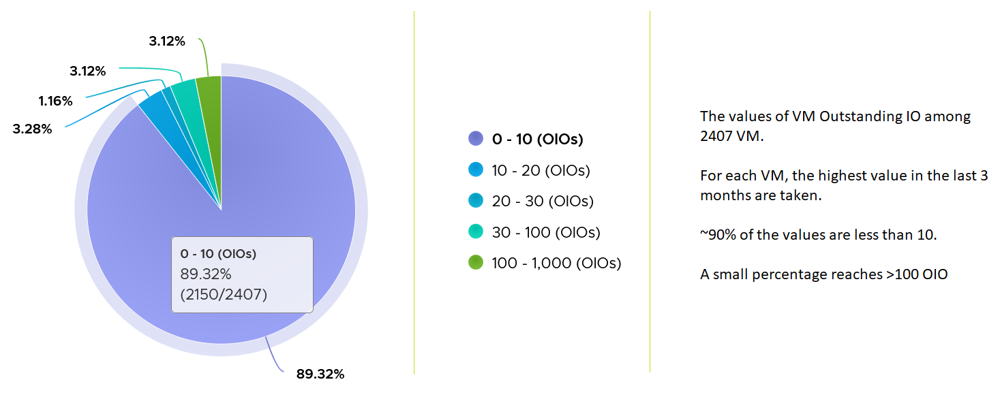

# VM Disk Latency

## Meaning
- Indicates a performance problem. A primary counter for how well the VM is served.
- Contrast: CPU Latency does not always indicate a performance problem. See `vsphere/technology/cpu/metrics/virtual-motherboard/latency`.
- Threshold setting by layer: see `foundations/thresholds`.

## Mechanism
- Latency can be high at low IOPS and throughput: each layer in the stack has its own queue (process, Guest OS storage subsystem, VM driver, kernel, array).
- Total latency is not (read latency + write latency) / 2. It is the average over all commands. 100 reads and 10 writes per second: total latency follows read latency.
- Read and write latency have different patterns. Often only one has a problem. Check both when troubleshooting.
- IP storage: storage read and write do not map 1:1 to network Receive and Transmit. A read sends a small command and its returned data arrives as Receive. See `vsphere/technology/storage/concepts/ip-storage-network-accounting`.

## Units and levels
- Virtual disk latency is provided in ms and in microseconds.
- Disk and datastore levels add Highest Latency, rolled up as Latest.
- Contention can come from the VM (an IOPS limit) or from the infrastructure.

## Threshold
- No universal threshold: ranges vary widely by storage. Profile your environment and compare with what the storage vendor sold.
- Example profile: more than 63 million data points (2,400 VMs × 3 months).


## Traps
- "Total latency = average of read and write latency" → it is weighted by command count.

## Metadata
```yaml
id: vsphere/technology/storage/metrics/virtual-motherboard/disk-latency
retriever_guide: metric-meaning
scope: vsphere
technology:
- storage
pillar:
- performance
product:
- vsphere
object:
- VirtualMachine
layer:
- virtual-motherboard
metric_class: contention
internal_derive:
- vsphere/foundations/vm-vs-guest-os
same_name:
- vsphere/technology/cpu/metrics/virtual-motherboard/latency
- vsphere/technology/memory/metrics/virtual-motherboard/latency
same_meaning: []
related:
- vsphere/technology/storage/concepts/ip-storage-network-accounting
- vsphere/technology/storage/metrics/virtual-motherboard/iops
- vsphere/technology/storage/diagnosis/vm-storage-performance-checks
- vsphere/technology/storage/concepts/guest-os-vs-vm-storage
- vsphere/technology/storage/metrics/virtual-motherboard/outstanding-io
- vsphere/technology/storage/metrics/virtual-motherboard/disk
- vsphere/technology/storage/metrics/virtual-motherboard/datastore
images:
  - path: ../../images/vm-virtual-disk-latency-distribution-across-vms.png
    product: [vsphere]
    object: [VirtualMachine]
    metric: ['VM Disk Latency']
    image_type: distribution
    sample: '2,400 VMs'
source:
  document: PART 3 - Counters.docx
  path: The World of Metrics > Metrics Nuances > Complexity > Naming Complexity; Storage > Architecture > VM Layer > Performance; Storage > VM > Performance Metrics > Contention Metrics
corrections:
- 'Section ''Mechanism'' (author answer Q022, 2026-11-04): the book says read and write both map to network Transmit. Wrong: they do not map 1:1 to Transmit and Receive; it depends on block size, MTU and TCP handshake packets. Keep until the book is updated.'
review_notes:
- 'Section ''Mechanism'': from Storage > Architecture.'
- 'Sections Units and levels, Threshold: from Storage > VM.'
status: draft
```
