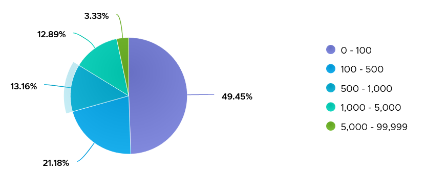

# VM Disk IOPS

## Under-reporting
- IO queued inside the Guest OS has not reached the hypervisor. VM-level IOPS does not include it. See [`vsphere/architecture/vm-vs-guest-os`](../../../../architecture/vm-vs-guest-os.md), area A.

## Limits
- A disk IOPS limit exists.
- A disk throughput limit does not exist. Throughput depends on block size, which varies, so a throughput limit is not practical.

## Values
- IOPS vary widely by workload and by busy vs quiet time.
- 1,000 IOPS averaged over 5 minutes = 300,000 commands. 10,000 IOPS = 3 million commands in 300 seconds.
- 3,500 production VMs over 1 week: about 85% never exceeded 1,000 IOPS; about 3% exceeded 5,000.
- High IOPS also load the shared pipe: a few VMs at 1 Gb/s each can saturate a 10 Gb link.
- Sustained load raises the chance of affecting other VMs. Discuss unusually high IOPS with the application team.
- Low IOPS with high throughput: large blocks. Compare with the planned block size.


## IOPS limit
- Set per virtual disk, not per VM. Not possible for snapshots or swap files.
- Default: no limit. Keep it.
- IO above the limit waits in the ESXi kernel queue: esxtop shows high QAVG, inside KAVG and GAVG, with normal DAVG (Broadcom KB 426790).
- mClock, the ESXi IO scheduler, counts an IO above 32 KB as several: a 100 IOPS limit with 320 KB IOs caps at about 10 IOs per second.
- VCF Operations per virtual disk: IOPS Limit property, IOPS per GB metric.

## Misconceptions
- "Latency is high, so the array is slow" → an IOPS limit shows as high QAVG and KAVG with normal DAVG; check the disk's limit.

## Metadata
```yaml
id: vsphere/technology/storage/metrics/virtual-motherboard/iops
retriever_guide: metric-meaning
scope: vsphere
technology:
- storage
pillar:
- performance
product:
- vsphere
object:
- VirtualMachine
layer:
- virtual-motherboard
metric_class: consumption
internal_derive:
- vsphere/architecture/vm-vs-guest-os
- sp5-framework/observability/resource-nature
same_name: []
same_meaning: []
related:
- vsphere/technology/storage/metrics/virtual-motherboard/disk-latency
images:
  - path: ../../images/vm-disk-iops-distribution-across-vms.png
    product: [vsphere]
    object: [VirtualMachine]
    metric: ['VM Disk IOPS']
    image_type: distribution
    sample: '3,500 VMs'
source:
  document: Knowledge base
  path: The World of Metrics > Metrics Nuances > Complexity > Architecture Complexity; Storage > VM > Performance Metrics > Consumption metrics
corrections: []
review_notes:
- 'Sections Values, IOPS limit: from Storage > VM.'
- 'To check: Section ''Under-reporting'': a request waiting in a guest queue before the virtual disk is not yet in the VM counters, but once issued and completed it is, so the IOPS over an interval equal the guest transfers per second when the queue drains. See guest-os/storage/disk-queue (reading of the guest queue).'
status: draft
```
