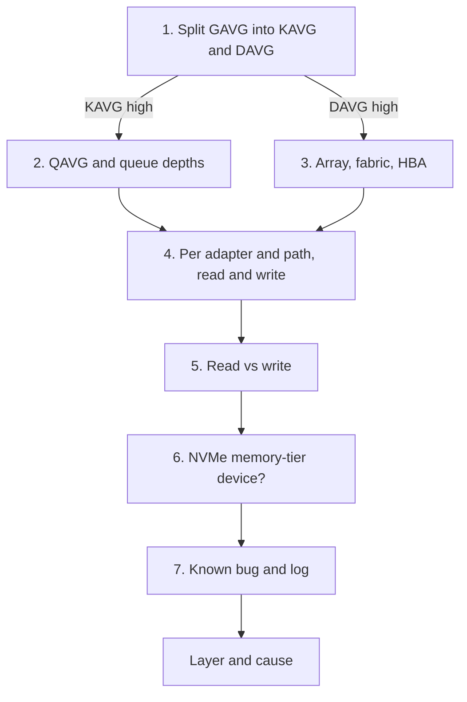

# ESXi storage latency is high

## Symptom
- ESXi disk latency (GAVG) is high on a host, the disk rows of ESXi Performance (%) are yellow or worse, or many VMs on one host or datastore show disk latency.
- Entered from `vsphere/object-types/esxi/health-check/esxi-health-check` (step 3) or `vsphere/technology/storage/troubleshooting/vm-storage-performance-checks` (step 5).

## Flow


## Checks, in order
1. Split GAVG into KAVG and DAVG (HostSystem) (`vsphere/technology/storage/concepts/esxi-storage-latency-stack`). KAVG above 0.5 ms → step 2. DAVG high → step 3.
2. Kernel queue (HostSystem). QAVG and the queue depths at each level of the stack. → step 4.
3. Device (HostSystem). Healthy DAVG is well within 5 ms. DAVG high: check the array. Array latency low: the fabric or HBA configuration. → step 4.
4. Per adapter and path (HostSystem) (`vsphere/technology/storage/metrics/host/adapter-and-path`). Read and write latency separately. Use the 95th or 99th percentile, not the maximum. → step 5.
5. Read vs write (HostSystem). Write-only latency is expected when reads hit cache. → step 6.
6. NVMe memory-tier device (HostSystem). High latency at near-zero IO is a wake-up penalty, not a fault. → step 7.
7. Known bug and log (HostSystem): driver and firmware versions against the compatibility guide and known issues; events in the window (`sp5-framework/performance/troubleshooting/vm-slow`, its known bug and log checks).

## Why this order
- The split first: kernel and device latency have different owners, the ESXi host and the array.
- Per adapter and path after the split: one bad path hides in the host total.
- Percentiles, not the maximum: one outlier sample is not a host problem.
- Memory-tier devices last: their latency pattern looks like a fault and is not.

## How to read the result
- KAVG high, DAVG low: queuing inside ESXi; queue depths or a saturated adapter.
- DAVG high, array latency low: the fabric or the HBA configuration.
- DAVG high, array latency high: the array.
- Thresholds of the vSphere documentation differ: `vsphere/tools/vsphere-client/performance-guidance`.

## Misconceptions
- "Kernel latency should correlate with device latency" → when both are healthy they need not.
- "The maximum latency of the hour shows the problem" → use the 95th or 99th percentile per adapter and path.

## Metadata
```yaml
id: vsphere/technology/storage/troubleshooting/host-storage-latency
retriever_guide: troubleshooting
scope: vsphere
technology:
- storage
pillar:
- performance
product:
- vsphere
object:
- HostSystem
internal_derive:
- vsphere/technology/storage/concepts/esxi-storage-latency-stack
- vsphere/technology/storage/metrics/host/adapter-and-path
- sp5-framework/performance/troubleshooting/vm-slow
related:
- vsphere/technology/storage/metrics/host/disk
- vsphere/technology/storage/metrics/host/datastore
- vsphere/tools/vsphere-client/performance-guidance
- vsphere/technology/storage/metrics/datastore/storage-io-control
- sp5-framework/performance/performance-management
source:
  document: Private Cloud Management by Iwan Rahabok (https://isvara.io/download)
  path: Storage > ESXi > Disk or Device; Storage Adapter & Path
corrections: []
review_notes:
- 'The vSphere 9.1 documentation gives other values: kernelLatency best 0-1 ms and a problem above 4 ms; deviceLatency above 15 ms; queueLatency must be 0 (vSphere Monitoring and Performance > Solutions for Disk Performance Problems, p. 2121). Kept in vsphere/tools/vsphere-client/performance-guidance.'
status: draft
```
