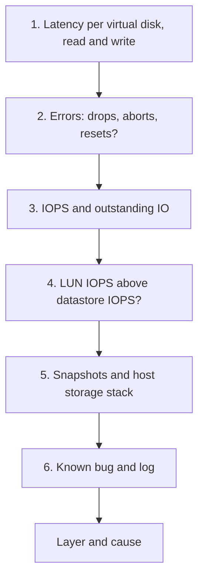

# VM disk latency is high

## Symptom
- VM disk latency is high, or the disk row of VM Performance (%) is yellow or worse.
- Entered from `sp5-framework/performance/troubleshooting/vm-slow` (step 4), a health check performance step, or an alert.

## Flow


## Checks, in order
1. Latency (VirtualMachine) (`vsphere/technology/storage/metrics/virtual-motherboard/disk-latency`). Per virtual disk, not only the VM aggregate; read latency and write latency separately. Only read or only write affected is common: look at that side only. → step 2.
2. Errors (VirtualMachine, Datastore). Packet loss for IP storage, dropped frames for FC, aborted SCSI commands for block storage: signs of contention on a shared datastore. Bus resets and commands aborted should be 0 all the time; track them at higher-level objects with a super metric (max or sum) and expect a flat line. → step 3.
3. Consumption (VirtualMachine). IOPS and throughput, with outstanding IO (`vsphere/technology/storage/metrics/virtual-motherboard/iops`, `vsphere/technology/storage/metrics/virtual-motherboard/outstanding-io`). Latency with low IOPS: queues in one of the layers. → step 4.
4. Backing device ratio (Datastore): LUN IOPS / datastore IOPS. Above 1: array-side IO (replication, snapshots). → step 5.
5. Configuration (VirtualMachine, HostSystem). Snapshots on the VM add IO and latency (`vsphere/technology/storage/concepts/snapshot-impact`). Latency on many VMs of one host or datastore → `vsphere/technology/storage/troubleshooting/host-storage-latency` to split kernel and device latency. → step 6.
6. Known bug and log (VirtualMachine, HostSystem): `sp5-framework/performance/troubleshooting/vm-slow`, its known bug and log checks.

## Why this order
- Latency per disk first: a VM aggregate hides the one slow disk, and read and write often have different causes.
- Errors next: drops and aborts are contention with an availability impact, and they explain latency at any load.
- Consumption after: it tells the VM's own load from a queue elsewhere.
- The array-side ratio before the host stack: IO the VM did not issue explains latency the VM did not cause.

## How to read the result
- Latency with low IOPS: queues in one of the layers (`vsphere/technology/storage/concepts/storage-layers`).
- Only read or only write affected: common. Look at that side only.
- Latency on one VM only, with a snapshot: the snapshot first.
- Latency on many VMs of a host or datastore: the host or the array, not the VM.

## Misconceptions
- "Low IOPS, so latency cannot be a storage problem" → queues add latency at any load.
- "The VM aggregate latency is fine, so every disk is fine" → read each virtual disk.

## Metadata
```yaml
id: vsphere/technology/storage/troubleshooting/vm-storage-performance-checks
retriever_guide: troubleshooting
scope: vsphere
technology:
- storage
pillar:
- performance
product:
- vsphere
- vcf-operations
object:
- VirtualMachine
- Datastore
internal_derive:
- vsphere/technology/storage/metrics/virtual-motherboard/disk-latency
- vsphere/technology/storage/concepts/storage-layers
- vsphere/technology/storage/metrics/virtual-motherboard/iops
- vsphere/technology/storage/metrics/virtual-motherboard/outstanding-io
- vsphere/technology/storage/concepts/snapshot-impact
- vsphere/technology/storage/troubleshooting/host-storage-latency
- sp5-framework/performance/troubleshooting/vm-slow
related:
- sp5-framework/performance/performance-management
source:
  document: Private Cloud Management by Iwan Rahabok (https://isvara.io/download)
  path: Storage > Architecture > VM Layer > Performance; Backing Device
corrections: []
review_notes: []
status: draft
```
