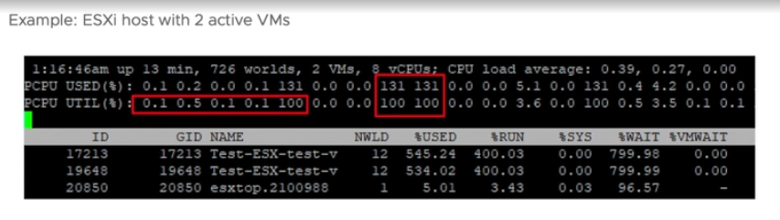
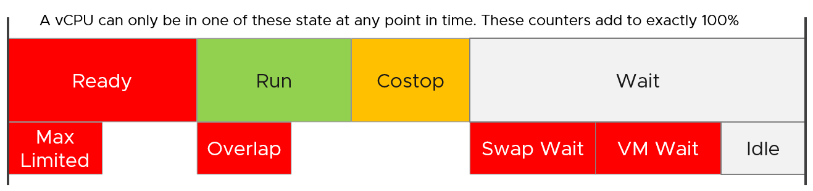
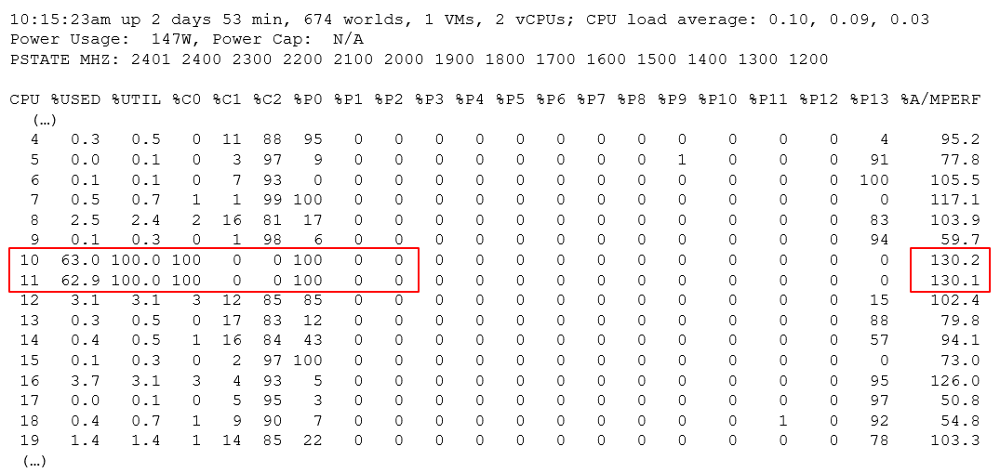

# esxtop CPU counters

## Summary lines (provider view)
- Line 1: physical CPU load average over 1, 5 and 15 minutes.
- Load average counts running and ready-to-run worlds. 1.00 = all PCPUs fully used. 2.00 = demand for twice the PCPUs present. 0.50 = PCPUs half used.
- Then PCPU USED (%), PCPU UTIL (%) and CORE UTIL (%). Used builds on Utilization and is more complex.
- Used (%) can exceed 100% (example 131%) while Utilization maxes at 100%.
- Used (%) maps to vSphere Client Usage (%); Utilization (%) maps to Utilization (%).
- PCPU = hardware execution context: a core with SMT off, a thread with SMT on. Not a socket. 10 cores × 2 threads = 20 PCPUs.
- CORE UTIL (%) appears only when Hyper-Threading is active. In batch mode it is repeated for each PCPU of the core: PCPU 0 and PCPU 1 both show core 0's value.
- PCPU UTIL (%) is per PCPU and CORE UTIL (%) per core, each at most 100%. No line adds the two threads of a core: with both threads busy, each PCPU UTIL reads 100% and CORE UTIL 100% ([`vsphere/technology/cpu/concepts/hyper-threading`](../../technology/cpu/concepts/hyper-threading.md), section Thread Utilization).
- Each line ends with per-NUMA-node averages and AVG for the whole host: spots an overloaded NUMA node.


## Detail table (consumer view)
- Mixes VM and non-VM worlds. Non-VM worlds have Ready but no VM Wait.
- The system group shows high Ready because it contains the idle thread.

## State counters


| Counter | Meaning |
|---|---|
| %USED | Not a state: affected by power management and Hyper-Threading. |
| %RUN | Run. See [`vsphere/technology/cpu/metrics/virtual-motherboard/run`](../../technology/cpu/metrics/virtual-motherboard/run.md). |
| %SYS | System. See [`vsphere/technology/cpu/metrics/virtual-motherboard/system`](../../technology/cpu/metrics/virtual-motherboard/system.md). |
| %WAIT | Wait = %VMWAIT + %IDLE. %VMWAIT includes %SWPWT. |
| %VMWAIT, %SWPWT, %IDLE | Components of Wait. VCF Operations uses a VM Wait that excludes Swap Wait: different remediation. |
| %RDY | Ready, summed over vCPUs: can exceed 100%. |
| %CSTP | Co-stop, 100% per vCPU. |
| %OVRLP | Overlap. |
| %MLMTD | Max Limited: halted by a manual limit, not by lack of CPU. Counted inside %RDY. Limits should not be set. |

```text
%USED = %RUN + %SYS - %OVRLP
100% = %RUN + %RDY + %CSTP + %WAIT      (per vCPU world)
```
- On a Hyper-Threading host a world's %USED falls below its %RUN while the sibling thread runs: %USED carries the same Hyper-Threading charge as VM CPU Used ([`vsphere/technology/cpu/concepts/hyper-threading`](../../technology/cpu/concepts/hyper-threading.md), section Hyper-Threading accounting: VM CPU Used and ESXi CPU Used).
- PCPU USED (%) follows ESXi CPU Used, not VM CPU Used: with both threads of a core busy, the %USED of the two vCPU worlds adds to more than the PCPU USED of the two threads. The rates are in the same section of [`vsphere/technology/cpu/concepts/hyper-threading`](../../technology/cpu/concepts/hyper-threading.md).
- A clock below nominal lowers %USED below %RUN; Turbo raises %USED above %RUN.
- %WAIT includes %IDLE. %WAIT - %IDLE (= %VMWAIT) of the vCPU worlds estimates guest IO wait. Expand the VM with e and read the worlds named vcpu. Estimate only: a vCPU also waits for events other than IO.
- A world's percentages are of one physical core. A resource pool at 30% %USED on a 2-way host uses 30% of one core, not of the host.

## Event counts
| Counter | Meaning |
|---|---|
| SWTCH/s | World switches per second. Lower is better. Likely correlates with overcommit, VM count and load. |
| MIG/s | NUMA and core migrations per second. |
| WAKE/s | Wake-ups per second (Wait to Ready). High values can hurt performance. |

- QEXP/s was removed in ESXi 6.5.
- Microbursts can make Ready high relative to Run: many scheduling events, each cheap. Check these counters.

## Summary stats
| Counter | Meaning |
|---|---|
| %LAT_C | CPU Latency. See [`vsphere/technology/cpu/metrics/virtual-motherboard/latency`](../../technology/cpu/metrics/virtual-motherboard/latency.md). |
| %LAT_M | Memory Latency. See [`vsphere/technology/memory/metrics/virtual-motherboard/latency`](../../technology/memory/metrics/virtual-motherboard/latency.md). |
| %DMD | Demand. See [`vsphere/technology/cpu/metrics/virtual-motherboard/demand`](../../technology/cpu/metrics/virtual-motherboard/demand.md). |
| EMIN | Minimum MHz the world gets when there is not enough for all. |
| TIMER/s | Timer rate of the world. |
| AFFINITY BIT MASK | Current scheduling affinity. Not set for Latency Sensitivity High VMs. |
| CPU | PCPU the world ran on (often blank). |
| EXC_AF | Yes: exclusive affinity (Latency Sensitivity). |

- HTQ (quarantine) is no longer shown since ESXi 7.0. The vSphere 9.1 documentation still lists it: a documentation error.
- Only EMIN to EXC_AF are absent from vSphere Client and VCF Operations.

## Allocation
| Counter | Meaning |
|---|---|
| AMIN | Reservation. |
| AMAX | Limit. |
| ASHRS | Shares. |
| AMLMT | Max limited. |
| AUNITS | MHz for VMs; percent for kernel modules. |

## Power
- Power stats (per VM and kernel module): POWER = current CPU power in watts (CPU only).
- Power panel (per PCPU): Power Usage (W) and Power Cap (hard limit, only when rack power is short). PSTATE MHZ lists the frequency per P-state.

| Counter | Meaning |
|---|---|
| %USED | Used (%). |
| %UTIL | Thread utilization, not core. |
| %CState, %PState, %TState | Time in each state. |
| %A/MPERF | Actual / nominal performance. Above 100%: Turbo. Below: power saving. Valid only in C0. Per PCPU, not per vCPU. Since ESXi 6.5; not in vSphere Client. |

```text
current frequency = %A/MPERF x nominal frequency
```
- With ACPI Collaborative Processor Performance Control (CPPC) enabled, the hardware controls frequency: PSTATE MHZ shows Hardware Controlled and no %Px columns appear. Use %A/MPERF for the frequency.
- Without CPPC, on Processor Clocking Control systems, P0 is time at full speed and P1 is time at any lower speed.
- Example: PCPU 10 and 11 share core 6, both Utilization 100%, %A/MPERF 130%, C0 and P0. Used shows 63.0% and 62.9%: Used adds to 100% per core (50% per thread) × 130% Turbo = 65%.


## Interrupts
| Counter | Meaning |
|---|---|
| COUNT/s | Interrupts per second, all CPUs. |
| COUNT_x | Interrupts per second on CPU x. |
| TIME/int | Average processing time per interrupt (µs). |
| TIME_x | Average per interrupt on CPU x (µs). |
| DEVICES | Devices on the vector; angle brackets mean not enabled. |

- Device list: `sched-stats -t sys-service-stats` (service, count, time, name such as VMK-igbn-rxq0, TCPIPRX, Netpoll, SCSI).
- Some services are reported under VMK-timer, for example vDS IOChain.

## Misconceptions
- "%RDY 300% is impossible" → summed over vCPUs.
- "%A/MPERF per VM" → per physical CPU only.
- "PCPU USED of a busy thread pair equals the %USED of the vCPU worlds on it" → the worlds carry the Hyper-Threading charge of VM CPU Used (1.25x per core) and PCPU USED does not, so the worlds add to more.

## Metadata
```yaml
id: vsphere/tools/esxtop/cpu
retriever_guide: metric-meaning
scope: vsphere
technology:
- cpu
- system
pillar:
- performance
product:
- vsphere
object:
- HostSystem
- VirtualMachine
metric_class: contention
internal_derive:
- vsphere/technology/cpu/concepts/vcpu-states
- vsphere/technology/cpu/concepts/hyper-threading
same_name: []
same_meaning: []
related:
- vsphere/tools/esxtop/overview
- vsphere/technology/cpu/concepts/power-states
- vsphere/technology/cpu/concepts/cpu-frequency
images:
  - path: images/esxtop-cpu-used-above-100-while-utilization-at-100.png
    product: [vsphere]
    object: [HostSystem]
    metric: ['esxtop %USED', 'esxtop %UTIL']
    image_type: screenshot
  - path: images/esxtop-cpu-state-counters-composition.png
    product: [vsphere]
    object: [HostSystem, VirtualMachine]
    metric: ['esxtop %RUN', 'esxtop %USED', 'esxtop %SYS', 'esxtop %OVRLP']
    image_type: diagram
  - path: images/esxtop-power-sibling-threads-at-100-percent-with-turbo.png
    product: [vsphere]
    object: [HostSystem]
    metric: ['esxtop %A/MPERF', 'esxtop %UTIL']
    image_type: screenshot
source:
  document: Knowledge base; VMware vSphere 9.1 product documentation (PDF built 2026-11-02; the copyright page carries no revision number); Broadcom KB 335065
  path: Provider Objects > esxtop > CPU; vSphere Monitoring and Performance > Performance Monitoring Utilities (resxtop and esxtop) > CPU Panel, CPU Power Panel (pp. 2150-2155); KB 335065 (CPU usage increase after update to ESXi 7.0.3 or later), Cause
corrections:
- 'Section ''State counters'': the vSphere 9.1 documentation, CPU Panel, %RUN (p. 2154), says %RUN can be twice as large as %USED on a Hyper-Threading host. Hyper-Threading alone brings a world''s %USED to 62.5% of %RUN at nominal clock (Broadcom KB 335065: a flat 25% throughput benefit for the core); twice needs a clock below nominal as well.'
- 'Section ''State counters'': the vSphere 9.1 documentation, CPU Panel, PCPU USED(%) (p. 2153), says PCPU USED equals the total sum of %USED of the worlds that ran on the PCPU. With both threads of a core busy, each PCPU shows half of the core (the same row says so) while each world is charged 62.5%, so the worlds add to more.'
- 'Section ''Summary stats'': the vSphere 9.1 documentation, CPU Panel (p. 2154), still lists HTQ; the field is not shown since ESXi 7.0.'
review_notes:
- 'To check: Sections ''Summary stats'' and ''Allocation'': what the CPU column shows (always blank in tests) and whether AMLMT shows when a limit is applied; a live esxtop reading of a VM with a CPU limit.'
status: draft
```
