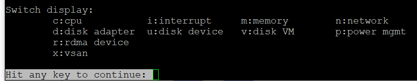

# esxtop overview

## Nature
- esxtop has no Guest OS metrics, although its manual says "guest". Guest OS and VM are different realms.
- It shows consumer (VM, vCPU) and provider (core, thread) objects side by side.
- Best for real-time troubleshooting on a known host. Not for capacity (weeks or months).

## Panels regrouped


| Group | Consumer view | Provider view | Panels |
|---|---|---|---|
| CPU | Yes | Partly: the 4-line summary | CPU, Power Management (CPU only, no socket level; thread level when HT is on), Interrupt |
| Memory | One shared panel | Summary at top | Memory |
| Storage | Disk VM | Disk Adapter + Disk Device (analyze together) | Plus vSAN (disk metrics only). No path panel. |
| Network | One shared panel | - | Network, RDMA device |

## Navigation
- V: show only VMs.
- G: show only groups matching a string (regular expressions allowed).
- g: inside an expanded group, show only matching worlds (for example storage or network worlds of a large VM).
- F: choose fields; %State Times is the most useful CPU field set.
- A VM row has %VMWAIT; non-VM worlds do not.

## Collection modes
| Mode | How | Sampling |
|---|---|---|
| Interactive | `esxtop` on the host, or `resxtop --server <host or vCenter> [--vihost <host>]` from Linux | Default 5 seconds between updates; minimum 2 seconds. |
| Batch | `esxtop -b -a -d <seconds> -n <iterations> > file.csv` | Minimum supported delay 10 seconds; shorter can cause issues. Runs until n iterations or Ctrl+C. |
| Replay | Collect with `vm-support -p -i <interval> -d <duration>`, extract, then `esxtop -R <directory>` | Replays the snapshots captured by vm-support. |

- esxtop samples are much finer than vCenter history (20-second real-time, 5-minute 1 Day). Use batch mode to keep a burst for later analysis. See [`vsphere/tools/vsphere-client/vcenter-statistics`](../vsphere-client/vcenter-statistics.md).
- `-a` exports every counter. Without it, batch exports the fields saved with the W command in the configuration file.
- Replay works only on esxtop of the same ESX version that produced the vm-support bundle. Batch CSV output cannot be replayed.
- Secure mode (`-s`) disables changing the delay.

## Export
- Avoid CSV export of everything: over 100 MB and more than 10,000 metrics (example: 16,384). Limit metrics and duration.

## Misconceptions
- "esxtop shows guest metrics" → VM and kernel only.

## Metadata
```yaml
id: vsphere/tools/esxtop/overview
retriever_guide: how-it-works
scope: vsphere
technology:
- cpu
- memory
- storage
- network
- system
pillar:
- performance
product:
- vsphere
object:
- HostSystem
- VirtualMachine
internal_derive: []
related:
- vsphere/tools/vsphere-client/vcenter-statistics
- vsphere/tools/esxtop/cpu
images:
  - path: images/esxtop-panels-overview.png
    product: [vsphere]
    object: [HostSystem]
    topic: 'esxtop panels'
    image_type: diagram
source:
  document: Private Cloud Management by Iwan Rahabok (https://isvara.io/download)
  path: Provider Objects > esxtop > Overview
corrections: []
review_notes:
- 'Section ''Collection modes'': from the vSphere 9.1 documentation (PDF built 2026-11-02), vSphere Monitoring and Performance > Performance Monitoring Utilities: resxtop and esxtop > Using the resxtop Utility, Interactive Mode, Batch Mode, Replay Mode (pp. 2148-2166).'
status: draft
```
