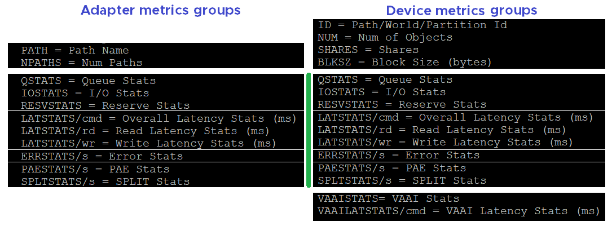

# esxtop storage counters

## Panels
- Three panels: Disk VM (consumer), Disk Adapter and Disk Device (provider).
- No path panel: it would show dead or inactive paths (all zeros) and lopsided active/active paths.
- No datastore panel: VMFS is covered by Device with 1:1 mapping and no extents.
- NFS datastores do appear in the Disk Device panel, as pseudo-devices prefixed {NFS} (for example {NFS}datastore1). esxtop abstracts storage at the File System Switch (FSS) layer; the VMkernel NFS client registers the pseudo-device for real-time IO tracking. It is not a physical device.
- An {NFS} row has IOPS, throughput, DAVG, KAVG and GAVG. Queue columns (DQLEN, QUED, %USD, LOAD) and QAVG show -: NFS has no SCSI device queue.
- For an {NFS} row, DAVG is the time beyond the host NFS client: the network and the NFS server.
- The vSphere Client lists only block devices managed by the Pluggable Storage Architecture (PSA). NFS is file-level: it bypasses PSA and NMP and has no naa., eui. or t10. identifier, so vCenter shows no device for an NFS mount.
- Adapter and Device share most contention and utilization groups.


## Disk VM (per VM and per virtual disk)
| Counter | Meaning |
|---|---|
| LAT/rd, LAT/wr | Average latency per read and per write (ms). |
| CMDS/s, READS/s, WRITES/s | IOPS: total, read, write. |
| MBREAD/s, MBWRTN/s | Throughput read and written (MB/s). |
| SC_UMP/s, FL_UMP/s, UMP/s | Successful, failed and total unmaps per second. Not available per VM in vSphere Client (host level only). |
| SC_UMP_MBS/s, FL_UMP_MBS/s | Same in MB/s. |
| NUMIOFILTERS, IOFILTERCLASS, FAILEDIO, TOTALIO, LATENCY | IO filter counters (replication, caching, QoS, encryption). Not in vSphere Client. FAILEDIO should be 0. Unclear whether LATENCY is filter overhead or total. |
| ID, GID, VMNAME, VSCSINAME, NDK | VSCSI device ID, resource pool ID, name, VSCSI device name, number of VSCSI devices. |

- Unmap failures: example fixed in ESXi 6.7 patch ESXi670-202008001: the guest did not refresh unmap granularity and hit a limit.

## Disk Adapter
| Group | Counters | Meaning |
|---|---|---|
| Errors | FCMDS/s, FREAD/s, FWRITE/s, FMBRD/s, FMBWR/s | Failed commands, reads, writes, and MB per second. Not in vSphere Client. Any value above 0: investigate. |
| Errors | CONS/s, FRESV/s, RESV/s | SCSI reservation conflicts, failed reservations, reservations per second. |
| Errors | ABRTS/s, RESETS/s | Commands aborted and reset per second. |
| Queue | AQLEN | Adapter queue depth: maximum active commands the driver supports. Not in vSphere Client. |
| Contention | DAVG, KAVG, GAVG, QAVG per /cmd, /rd, /wr | 12 latency counters (ms). Averages over the period. /cmd is weighted by reads and writes: write latency can hide in a read-heavy mix. |
| Consumption | ACTV | Commands currently active. |
| Consumption | CMDS/s, READS/s, WRITES/s, MBREAD/s, MBWRTN/s | IOPS and throughput. No total throughput: sum read and write. |
| PAE and split | PAECMD/s, PAECP/s | PAE commands and copies. Obsolete with 64-bit drivers. Paths only. |
| PAE and split | SPLTCMD/s, SPLTCP/s | Large IOs split by the kernel. Higher values reduce performance. |
| Configuration | NPTH | Number of paths. Should match the design. |

- See [`vsphere/technology/storage/concepts/esxi-storage-latency-stack`](../../technology/storage/concepts/esxi-storage-latency-stack.md) for GAVG, KAVG, QAVG, DAVG.

## Disk Device
| Group | Counters | Meaning |
|---|---|---|
| Errors | ABRTS/s, RESETS/s | Expect 0 always. |
| Queue | LOAD | (active + kernel-queued commands) / queue depth. Above 1: check QUED. |
| Queue | QUED | Commands queued in the kernel. Keep well below queue depth. |
| Queue | %USD | ACTV / QLEN (WQLEN for worlds, DQLEN for devices). 100%: queue full; outstanding IO and latency rise. |
| Queue | DQLEN, WQLEN | Device queue length (adapter equivalent: AQLEN); per-world maximum active commands. |
| Queue | ACTV | IO in flight. Expected small. |
| Contention, consumption, PAE and split | Same as Disk Adapter | 12 latency, 5 consumption, 4 PAE/split counters. |
| Configuration | Path, world, partition (one at a time; e shows one device) | Path names such as vmhba0:C0:T0:L0; per-world statistics; partition ID. |
| Configuration | NPH | Number of paths. 1 is a single point of failure. |
| Configuration | NWD, NPN | Number of worlds; number of partitions (expect 1 for VMFS). |
| Configuration | SHARES | Per world. |
| Configuration | BLKSZ, NUMBLKS | Block (sector) size in bytes and block count. Prefer 4K native (Advanced Format) or at least 512e. Capacity = BLKSZ × NUMBLKS. |

## VAAI (Device panel)
- Array offload; vendor dependent. No VAAI counters at adapter or path level.
- VAAI offload raises KAVG. Other latency counters are unaffected; no issue without other symptoms.

| Primitive | Counters |
|---|---|
| Extended copy (XCOPY, 0x83) | CLONE_RD, CLONE_WR, CLONE_F; LCLONE_RD, LCLONE_WR, LCLONE_F (linked clones); MBC_RD/s, MBC_WR/s; average latency per successful and failed command. |
| Atomic test and set (0x89) | ATS, ATSF (expect 0), AAVG/suc, AAVG/f. |
| Write same (0x93 or 0x41) | ZERO, ZERO_F, MBZERO/s, ZAVG/suc, ZAVG/f. |
| Unmap (0x42) | DELETE, DELETE_F (should be 0), MBDEL/s. |
| Other | RESSPACE, RESSPACE_F (thick VMDK space reservation); EXTSTATS, EXTSTATS_F; CAVG, LCAVG, RAVG, ESAVG per successful and failed command. |

## vSAN panel
- Storage only; vSAN network and CPU appear in their own panels.
- Five IO types: read, write, recovery write (component rebuild), unmap, recovery unmap.
- Per type: IOPS, bandwidth (some MB, some GB), average latency, standard deviation of latency (when above 10 ms).
- Counters: ROLE (DOM role: client, owner, component manager); READS/s, MBREAD/s; WRITES/s, MBWRITE/s; RECOWR/s, MBRECOWR/s; UNMAPS/s, GBUNMAP/s; RECOUN/s, GBRECOUN/s; AVGLAT, SDLAT.
- Excessive unmap can hurt performance.

## Misconceptions
- "DAVG/cmd low, so writes are fine" → check DAVG/wr.
- "High KAVG with VAAI is a problem" → expected with offloads.

## Metadata
```yaml
id: vsphere/tools/esxtop/storage
retriever_guide: metric-meaning
scope: vsphere
technology:
- storage
pillar:
- performance
- availability
product:
- vsphere
- vsan
object:
- HostSystem
- VirtualMachine
metric_class: contention
internal_derive:
- vsphere/technology/storage/concepts/esxi-storage-latency-stack
same_name: []
same_meaning: []
related:
- vsphere/tools/esxtop/overview
- vsphere/technology/storage/metrics/host/disk
- vsphere/technology/storage/metrics/host/adapter-and-path
images:
  - path: images/esxtop-disk-adapter-vs-disk-device-metric-groups.png
    product: [vsphere]
    object: [HostSystem]
    topic: 'esxtop storage'
    image_type: diagram
source:
  document: Private Cloud Management by Iwan Rahabok (https://isvara.io/download)
  path: Provider Objects > esxtop > Storage
corrections:
- 'Section ''Panels'': the book says esxtop does not cover NFS. NFS datastores show in the Disk Device panel as {NFS} pseudo-devices with DAVG, KAVG and GAVG.'
review_notes:
- 'Section ''Disk Adapter'': the book lists the guest write counter as ''AVG/wr'' and the clone latency as ''AVAG''; read as GAVG/wr and an average clone latency.'
- 'To check: VAAI references from the book, not read: https://kb.vmware.com/s/article/2065193, https://blogs.vmware.com/vsphere/2012/06/low-level-vaai-behaviour.html, https://www.running-system.com/esxtop-vaai-counters/'
status: draft
```
