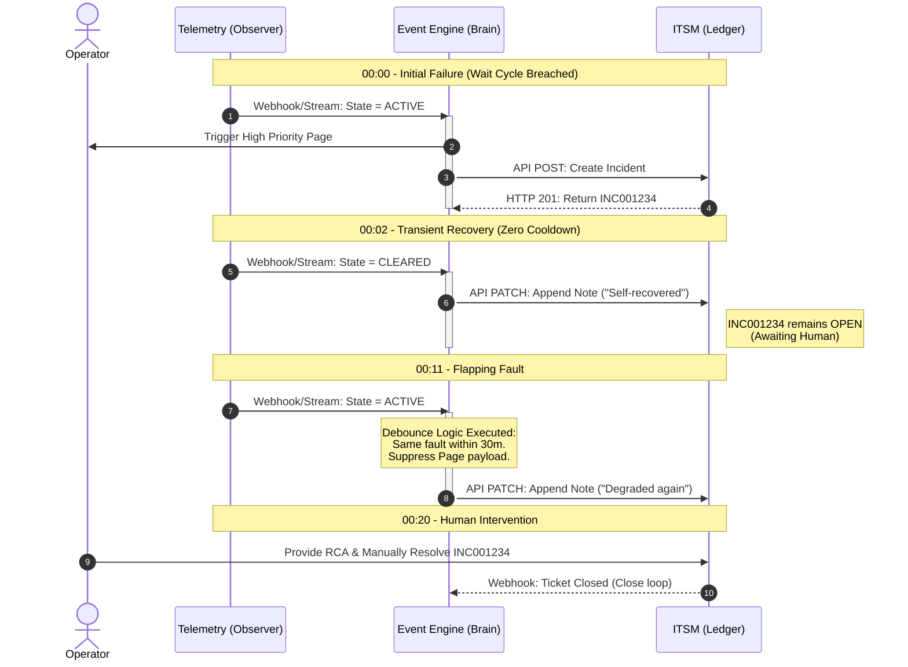

# Alert Close Cycle Design: Architectural Best Practices

## 1. Core Principle: State Decoupling

The fundamental rule of modern enterprise alerting is the absolute decoupling of the **Telemetry State** (the physical reality of the metric) from the **Incident State** (the human operator workflow). Conflating these two lifecycles by using artificial time delays (cooldowns) at the metric level causes split-brain scenarios, alert flapping, and missed critical events.

To enforce this decoupling, the operations management architecture must be divided into three distinct layers:
1. **Telemetry Engine (The Observer):** Evaluates raw metrics, enforces Wait Cycles (Time-to-Fire), and clears states immediately based on mathematical thresholds.
2. **Event Management Engine (The Brain):** The AIOps layer that executes debouncing, suppresses flapping, correlates symptoms, and pages human operators.
3. **ITSM (The Ledger):** The system of record (e.g., ServiceNow). It receives curated API calls from the Event Engine. It does not execute operational logic; it only records state and workflow.

---

## 2. Telemetry State Rules (The Observer)

The Telemetry Engine must reflect the exact real-time condition of the infrastructure without artificial delays on recovery.

* **Eradicate Time-Based Cooldowns:** Never configure an alert to wait an arbitrary time (e.g., 10 minutes) before closing after a metric normalizes. Time-based cooldowns create a "Suppression Trap" where new, worsening symptoms are ignored because the alert is artificially held in an active state.
* **Enforce State-Based Hysteresis:** Use disparate thresholds for triggering and clearing to prevent metric jitter. 
  * *Example:* Trigger if disk latency `> 20ms`. Clear if latency `< 10ms`.
* **Immediate Symptom Cancellation:** Once the metric crosses the lower hysteresis threshold, the Telemetry Engine must change the state to `CLEARED` instantly.

---

## 3. Incident State Rules (The Brain & The Ledger)

The Event Management Engine absorbs the immediate cancellations from the Telemetry layer and applies logic to protect the human operator.

* **Incident Debouncing (Flap Protection):** If a Telemetry Alert clears and re-triggers within a defined window (e.g., 30 minutes), the Event Engine must append the new trigger to the *existing* open Incident ticket. It must **not** issue a new page.
* **Human-Gated Closure for Criticals:** If a severity warrants waking an operator (P1/P2), the auto-cancellation of the Telemetry Alert must *not* auto-close the ITSM Incident Ticket. The ticket status updates to reflect the metric recovery, but requires manual human closure and root cause documentation.
* **Auto-Closure for Low Priority:** For performance or capacity alerts routed to daily dashboards (P3/P4), the Event Engine should auto-close the ticket synchronously with the Telemetry cancellation.

---

## 4. Architectural Workflows

The following diagrams illustrate how the 3-tier architecture behaves during a complex hardware failure (a transient recovery followed by a secondary flap). 

### 4.1 Chronological Impact (Horizontal Timeline)

This timeline chart demonstrates the operator experience. Because the architecture uses debouncing instead of a metric cooldown, the dashboard accurately reflects reality at every minute, yet the operator is only paged once.

```mermaid
timeline
    title 3-Tier Alert Lifecycle (Horizontal Time Axis)
    
    00:00 (Trigger)
        : Telemetry (Observer) : Wait Cycle breached. State changes to ACTIVE.
        : Event Engine (Brain) : Triggers Page. Calls ITSM API.
        : ITSM (Ledger) : Creates INC001234 (Status: New).
        
    00:02 (Recovery)
        : Telemetry (Observer) : Hardware stabilizes. State changes to CLEARED.
        : Event Engine (Brain) : Dashboard goes Green. Calls ITSM API.
        : ITSM (Ledger) : Appends "Self-recovered" note. Ticket stays OPEN.
        
    00:11 (Flap)
        : Telemetry (Observer) : Hardware fails again. State changes to ACTIVE.
        : Event Engine (Brain) : Debounce rule hit. NO Page. Calls ITSM API.
        : ITSM (Ledger) : Appends "Degraded again" note. Ticket stays OPEN.
        
    00:20 (Resolution)
        : Operator : Fixes hardware. Types RCA and clicks Resolve in ITSM.
        : Telemetry (Observer) : State remains CLEARED.
        : ITSM (Ledger) : Status changes to Resolved.
```

### 4.2 Engineering Payload Flow (Sequence Diagram)

This sequence diagram illustrates the state synchronization barrier. It proves that the ITSM acts purely as a ledger and never communicates directly with the Telemetry Engine, isolating the ITSM database from raw telemetry noise.



---

## 5. Summary of Anti-Patterns Avoided

By adhering to this 3-tier architecture and zero-cooldown policy, organizations avoid:
1. **The Split-Brain:** Operators no longer see active alerts for metrics that are currently healthy.
2. **The Suppression Trap:** Worsening symptoms are no longer masked by active cooldown timers.
3. **Alert Flapping:** Notification storms are eliminated via Event Engine debouncing rather than artificially manipulating raw metric data.