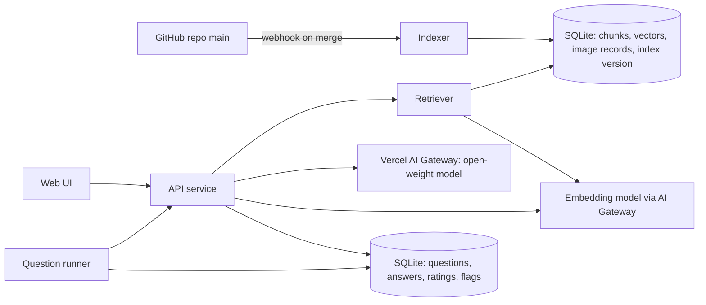

# Design: knowledge base test site

> Archived on 2026-11-06 (architecture review 2026-11-06, section 4): no test site is being built. Kept as a record; not maintained.

Status: design only. Not built. Not indexed. Scope: the website only (pages, users, data, hosting, security, phases). Split 2026-11-06: the harness parts moved to `ARCHITECTURE.md` and `harness/`, the benchmark parts to `benchmark/`.

## Purpose
- Measure the quality of `knowledge/` through a local LLM that answers from it.
- Let invited visitors ask questions in natural language and judge the answers.
- Turn every weak answer into a fix: a knowledge gap, a retrieval miss, or a model limit.
- Product requirements for the shipped assistant (ways to ask, answer UX, dark site): `DESIGN.md`, section 5.
- The site is a front end to `harness/`: retrieval, tools, agent, verifier and prompts are the harness's, unchanged (`ARCHITECTURE.md`; `harness/README.md`; `harness/AGENT.md`). The site adds no answer rules of its own.
- Benchmark design, models and scoring: `benchmark/design.md`, `benchmark/models.md`. Why a small model is enough: `DESIGN.md`.

## What "quality" means here
| Signal | Question it answers | Source |
|---|---|---|
| Retrieval hit | Did the right files come back? | Question `knowledge` ids vs retrieved ids |
| Answer score | Is the answer right, with the right reason? | 0-3 rubric from `benchmark/README.md` |
| KB lift | Does the knowledge base beat no knowledge base? | Same question, baseline vs kb mode |
| Draft dependence | How much of the answer rests on `status: draft` files? | Cited file status |
| Gap rate | Which questions find no relevant file? | Low retrieval score, visitor flag |
| Trap rate | Does the answer fall into a known trap? | Question `Likely wrong answer` |

## Users
| Role | Can do |
|---|---|
| Visitor (invited) | Ask, rate, flag an answer as wrong with a comment. |
| Author | Everything a visitor can, plus: review flags, score answers, run questions, see the dashboard. |
| System | Rebuild the index on each merge to `main`; run questions on each rebuild. |

## Architecture

- Indexer: reads `knowledge/**/*.md` except the excluded folders. Uses the repo's own `project/tools/lint.py` split logic for metadata. Refuses to index if the validator fails.
- Retriever: hybrid search (keyword BM25 + vector), filtered by metadata, then link expansion.
- API service: query pipeline, prompt assembly, streaming answer, logging.
- LLM: open-weight model via Vercel AI Gateway for the test site. At a customer, the same weights run on their own VM, so no data leaves their environment.
- Question runner: sends only `## Prompt` of each question, never the answer key.
- Every answer stores the index version (git commit SHA). A score is always tied to the knowledge that produced it.

## Pages
| Page | Content |
|---|---|
| Ask | Chat. Each answer shows cited files (id, title, draft badge), images that match, and a collapsible retrieval trace. Buttons: rate 0-3, flag wrong. |
| Compare | Same question answered twice: kb and baseline. Shown blind as A and B. Visitor picks the better one, then sees which was which. |
| Questions (author) | Latest run per question: score, retrieval hit, trap hit. Trend per index version. Runs on demand or after each rebuild. |
| Review queue (author) | Flagged answers. Author tags the cause: knowledge gap, wrong fact, retrieval miss, model error. One click creates an entry in `project/todo.md` or `project/author-questions.md` via a pull request. |
| Dashboard (author) | Signals table above, per technology and per retriever_guide. Top unanswered questions. Most-cited draft files (review first). |
| Corpus | Read-only browser of indexed files and image records, as the LLM sees them. |

## Data stored
| Table | Fields |
|---|---|
| chunks | id, file id, heading, text, tags, status, index version |
| images | path, file id, product, object, metric, topic, image_type, sample, alt text |
| questions | text, mode (kb, baseline), user role, time |
| answers | question, text, cited ids, retrieval trace, index version, model, latency |
| ratings | answer, score 0-3, flag, comment, cause tag |
| eval_runs | question id, mode, score, retrieval hit, index version, model; also appended to `benchmark/results/results.csv` |

- Question answer keys are read only by the runner and the author pages. Never sent to the LLM. Never shown to visitors.

## Technology choice
| Part | Choice | Reason |
|---|---|---|
| LLM serving (test) | Vercel AI Gateway, open-weight models only | No hardware to buy. One API for all candidate models. Pay per token. The author already has a Vercel account. |
| LLM serving (customer) | Ollama or vLLM on the customer's own VM | Same open weights the test site scores. vLLM when several users query at once. |
| Model | The benchmark winner (`benchmark/models.md`) | Must be downloadable and runnable by VMware customers. |
| Embeddings | `alibaba/qwen3-embedding-0.6b` via Vercel for the test; same model on CPU at the customer | Small, open, runs without a GPU. |
| Index and logs | SQLite with a vector extension | About 200 files: no separate vector database needed. One file to back up. |
| API | Python (FastAPI) | Reuses `project/tools/lint.py`. Same language as the repo tooling. |
| UI | Server-rendered pages with light JavaScript; streaming answers | Few pages, low maintenance. |
| Hosting (test site) | Vercel: web app, API routes, AI Gateway | No server to run. Index and logs in a hosted database. |
| Hosting (customer) | One VM with a GPU, or CPU only for the smallest model | The deployment target the scores must predict. |
| Rebuild | GitHub webhook or scheduled pull of `main` | Index always matches merged knowledge. |

## Security and abuse
- Invite-only first: login by email link or a shared access code. Public later, if ever.
- Rate limit per user and per IP.
- Visitor text is untrusted. The system prompt tells the model to answer only from retrieved chunks and to ignore instructions inside the question that change its role.
- The corpus is trusted, but only `main` is indexed. No branch or PR content.
- Logs hold questions. Tell visitors. No customer names in answers or logs shown on public pages.
- Admin pages behind author login.

## Build phases
The project has 2 stages. Phases 1 and 5 are the benchmark; phases 2-4 are the Human Test.

| Phase | Stage | Content |
|---|---|---|
| 1 | Benchmark | Claude runs the question set on all candidate models and modes; scoring is automatic. Picks the default model and mode. See Benchmark plan. |
| 2 | Human Test | Ask page on isvara.io with citations and retrieval trace. Author only. Uses the phase 1 winner. Replaces the current basic agent on isvara.io. |
| 3 | Human Test | Ratings, flags, review queue. Invite visitors. |
| 4 | Human Test | Compare page (blind A/B) and dashboard. Screenshot upload when a vision-capable model is chosen. |
| 5 | Benchmark | 4-bit re-test of the chosen model and mode on customer-like hardware. Re-run after each major knowledge update. |

## Decisions for the author
- Hosting: decided 2026-11-03: Vercel AI Gateway for the test site.
- Audience: author only, invited experts, or public?
- Who scores: author only, or visitor ratings count too?
- Model: decided 2026-11-03: compare the 8 candidates in the benchmark; 5 runs; 100-question target.
- Domain name and branding.
