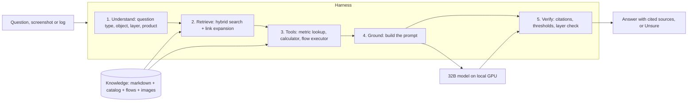

# Solution design: a local 32B model that beats frontier models on private cloud operations

Status: proposal, 2026-11-04. For the author and for VMware professionals who ask "how can a small local model beat GPT or Claude?". Not indexed.

## 1. Mission
- A 32B-class open-weight LLM, running locally on one GPU, answers Level 400 private cloud operations questions better than the best frontier model.
- Local means a dark site: no Internet, no cloud API, no data leaving the customer.
- Cheap means one server-class GPU, not a cluster, and no per-token fees.
- Scope:
  - version 1.0: vSphere 9.1 metrics, plus the Guest OS layer (Windows first);
  - later: vSAN, NSX, VCF Operations, VMware Kubernetes, Linux. The end scope is the whole private cloud stack.
- Target, measured on the benchmark: minimum 85%, target 99% Stable correct (correct in all 5 runs), with the confident-wrong rate near 0.

## 2. The system: model + harness + knowledge
- The product is not "a model". It is a compound AI system: three parts, each doing what it is best at.



| Part | Job | Why not leave it to the model |
|---|---|---|
| Knowledge | Holds the Level 400 facts, mechanisms, traps and flows. | A model's memory is the Internet's average, including its mistakes. |
| Harness | Finds the right knowledge, runs exact tools, checks the answer. | Retrieval, arithmetic and lookups are deterministic; software does them without error. |
| Model | Reads the retrieved text, reasons over it, writes the answer. | This is the part that needs language understanding. |

- Name for the wrapper: **harness**. It is the common term in agent engineering for the code around a model that supplies context, tools, control flow and checks. Other names in use: orchestration layer, RAG pipeline (narrower: retrieval only).
- Run-time walkthrough (who drives, one question step by step): `ARCHITECTURE.md`.
- The harness lives in `harness/`: `retrieval.py` (hybrid search, link expansion), `modes.py` (classic and agentic tool loop), `kb.py` (loads and chunks `knowledge/`), `llm.py` (model client). The benchmark runner (`benchmark/runner/`) drives the same harness, so the tested system is the shipped system.

## 3. Why a 32B model can beat a frontier model here
Six mechanisms, in order of weight.

1. **Open-book exam.** A frontier model's advantage is breadth of memorised knowledge plus reasoning depth. For one narrow domain, retrieval supplies the knowledge. What remains is reading 5-10 retrieved files and applying their rules: reading comprehension plus a short reasoning chain. On that task, current 27-32B models are close to frontier models.
2. **The frontier model memorised the wrong answers.** Its vSphere knowledge comes from forums, blogs and old documentation. That corpus repeats the misconceptions the author's book corrects: "Ready above 5% is bad", "memory usage at 95% means add RAM", "the VM is the Guest OS", "VM rightsizing". A model trained on it answers confidently and wrongly. Measured: the frontier model without the knowledge base fell into the trap answer on 16% of answers (run 20261103-093742).
3. **Currency.** vSphere 9.1 and VCF 9.1.1 behaviour (memory tiering, vHT, GPU counters at statistics level 4) is newer than most training data. The knowledge base is current by rule.
4. **Exactness from tools.** Small and large models both slip on arithmetic and unit conversion (ms summation to %, GHz × vCPU, KB vs kb). A calculator tool and a metric catalog lookup return exact values; the model only chooses which tool to call.
5. **Structure built for a small model.** One fact per bullet, one object per metric file, same-name traps linked, layers separated in folders and tags, metadata for filtering. Enterprise RAG usually fails on messy chunking; this corpus is written to be chunked.
6. **Measured, not claimed.** Every change is scored on a fixed benchmark against the frontier model, with luck removed (Unsure option, confident-wrong rate, 5 runs must agree).

- Honest status: not achieved yet. On 17 questions (old scoring), the best small model with the knowledge base scored 58%; the frontier model without it scored 75%. The gap is in specific questions (knowledge gaps, answer keys, the "ONLY the knowledge base" prompt rule, weak agentic tool use), each tracked in `project/author-questions.md` Q038-Q043 and `project/todo.md`.

## 4. Why 32B, not 70B or 8B
Decode speed and hardware are governed by memory: every generated token reads all active weights once.

| Size | Weights at 8-bit | Weights at 4-bit | Fits on | Relative decode speed (same GPU, same precision) |
|---|---|---|---|---|
| 8B dense | ~8 GB | ~5 GB | any 16 GB GPU | ~4x |
| 32B dense | ~32 GB | ~18 GB | one 48 GB GPU at 8-bit with room for context; one 24 GB GPU at 4-bit | 1x |
| 70B dense | ~70 GB | ~40 GB | 80 GB GPU, or two 48 GB GPUs | ~0.45x |
| 30B MoE, 3B active | ~30 GB | ~17 GB | same as 32B | ~5-8x (reads only active weights) |

- Add the KV cache for the retrieved context (8-12K tokens per question) on top of the weights.
- **Why not 70B:** twice the GPU memory and about half the speed of a 32B model, for a gain that is mostly memorised world knowledge. The harness replaces memorised knowledge with retrieved knowledge, so the 70B advantage shrinks to reasoning depth. The design rule: test a 70B model only if the best 32B model loses points through reasoning errors while the trace shows it read the right files (`project/design-kb-test-site.md`, Decision rules).
- **Why not 8B-14B:** too weak at multi-step reasoning and tool use. Measured: ministral-8b 29-40% exact (dropped); qwen-3-14b in agentic mode 19%.
- **Why dense over MoE as the main bet:** MoE models with 3-4B active parameters are fast, but in our run they did worst at tool use (nemotron-3-nano-30b-a3b: 24-29% exact; almost no tool calls). They stay in the test as the speed option.
- **Precision:** run 8-bit when the GPU allows; 4-bit costs a little accuracy on multi-step reasoning. The benchmark decides.
- The arithmetic above is standard inference sizing (parameters × bytes per parameter; decode is memory-bandwidth bound). Exact speeds depend on GPU, runtime and batch size.

## 5. Model selection
### Selection criteria
1. Open weights, with a licence that allows commercial on-premises use. Checked per model before deployment.
2. Size 24-35B total parameters: fits one data-center GPU (section 4).
3. Tool calling, for agentic retrieval and the calculator and catalog tools.
4. Context window of at least 32K tokens: system prompt + 8-12K retrieved text + answer.
5. Available both on the test gateway and as downloadable weights, so the tested model is the deployed model.
6. Vendor diversity: different training data fails on different questions. A mix shows whether a failure is a knowledge gap (all fail) or a model gap (one fails).
7. Vision for screenshot questions (a share of the benchmark).

### Candidates (in `benchmark/runner/config.yaml`)
| Model | Type | Why in the test | Result so far (17 questions, old scoring) |
|---|---|---|---|
| google/gemma-4-31b-it | 31B dense, vision | Strong instruction following; vision; long context | Best: 58% exact with one lookup |
| google/gemma-4-26b-a4b-it | 26B MoE, 4B active, vision | Same family, much faster: speed option | 45% |
| alibaba/qwen-3-32b | 32B dense | Reference dense model of the class | 48% |
| mistral/mistral-small | 24B dense, vision | Different vendor; vision | 51% |
| openai/gpt-oss-20b | 21B MoE | Fast reasoning model; Apache 2.0 | 48%; often broke the answer format in agentic mode |
| nvidia/nemotron-3-nano-30b-a3b | 30B MoE, 3B active | Fastest; tests the lower bound | 25% |
| alibaba/qwen-3-14b | 14B dense | Lower bound for size | 42% |
| alibaba/qwen3.8-27b | 27.8B dense, vision, Apache 2.0 | Newest Qwen dense model in the class (weights published 2026-08) | Added 2026-11-04 |
| alibaba/qwen3.6-27b | 27.8B dense, vision, Apache 2.0 | Previous Qwen dense generation (2026-04): shows the gain between generations | Added 2026-11-04 |
| zai/glm-4.7-flash | 31.2B MoE (30B-A3B), MIT | Fourth vendor; fast MoE with tool use | Added 2026-11-04 |

### Changes for the 100-question run (author decisions)
- 2026-11-04: added qwen3.8-27b, qwen3.6-27b and glm-4.7-flash. Licences and sizes checked on Hugging Face: Qwen/Qwen3.8-27B and Qwen/Qwen3.6-27B Apache 2.0, 27.8B parameters; zai-org/GLM-4.7-Flash MIT, 31.2B parameters.
- 2026-11-03: keep the 7 earlier models until 100 questions; ministral-8b dropped.
- **Frontier references:** one frontier model with and without the knowledge base each run (claude-opus-5.5 used so far).

### Not chosen, and why
| Model | Reason |
|---|---|
| Llama 3.3 70B | 70B: twice the hardware (section 4); older generation. |
| gpt-oss-120b, Nemotron 3 Super 120B, Qwen3 Next 80B | Over 80B total weights: multi-GPU or 80 GB GPU. MoE speed does not remove the memory need. |
| DeepSeek-R1-Distill-Qwen-32B | Early-2025 reasoning distill, superseded by newer 27-32B models with native tool use; long reasoning output raises latency. Not on the gateway. |
| Devstral Small, Qwen3 Coder 30B | Tuned for code, not for technical reading comprehension. |
| ministral-8b | Dropped after scoring 29-40%. |

## 6. Knowledge: what the harness needs, beyond markdown
Markdown prose is the core, but not enough. Each knowledge type matches a failure mode of small models.

- **Concepts and mechanisms**
  - Format: Markdown, one fact per bullet
  - What it fixes: The model knows the counter name but not why it behaves that way
  - Status: 209 files
- **Metric files with traps**
  - Format: Markdown + metadata (object, layer, same_name links)
  - What it fixes: Same name, different meaning on another object or layer
  - Status: Done for vSphere CPU, memory, storage, network
- **Metric catalog**
  - Format: YAML or CSV in the repo, compiled to SQLite by the harness: one row per metric per object, with counter id, unit, rollup, statistics level, layer, metric class, threshold with source
  - What it fixes: Exact lookups ("unit and rollup of Ready", "is GPU utilization stored by default?") without depending on retrieval luck
  - Status: Built 2026-11-04: `knowledge/catalog/vcenter-counters.yaml` (131 chart rows from the vSphere 9.1 docs), `esxtop-fields.yaml` (178 fields), `thresholds.yaml` (31 rows, each quoting its file; lint checks the quote), colour bands read from the knowledge files; `harness/catalog.py`
- **Object model**
  - Format: YAML: managed object types, parent-child and provider-consumer relationships
  - What it fixes: Multi-hop questions (VM → host → cluster → datastore)
  - Status: Built 2026-11-04: `knowledge/catalog/objects.yaml` (12 types, 18 relations, layers); path search in `harness/catalog.py`
- **Troubleshooting flows**
  - Format: Markdown numbered steps + Mermaid, plus a YAML step definition the harness can execute one step at a time
  - What it fixes: Small models skip steps or jump to conclusions; an executor keeps them on the path and asks for the next value
  - Status: 12 flows; executor built 2026-11-04 (`harness/flows.py`) reads the numbered steps from the markdown, so there is no second copy. Structured conditions only if traces show skipped steps
- **Formulas and calculators**
  - Format: Small functions in the harness, referenced from metric files
  - What it fixes: Arithmetic and unit errors
  - Status: Built 2026-11-04: `harness/calc.py` (summation ↔ %, units, capacity, esxtop identities)
- **Glossary and synonyms**
  - Format: One glossary with synonyms and words to avoid
  - What it fixes: Query rewriting: "steal time" → Ready; "VM rightsizing" → two sizing jobs
  - Status: Exists, split over 3 files
- **Diagrams and screenshots**
  - Format: PNG plus a full text twin next to each image
  - What it fixes: Text-only models lose nothing; vision models and human readers get the picture
  - Status: 100+ images
- **Worked examples**
  - Format: Markdown question → reasoning path → answer, separate from the benchmark
  - What it fixes: Shows the model how to chain the files; never the benchmark answers
  - Status: Missing

### Is HTML better than markdown?
- No. Markdown is the better source format for this corpus.
- HTML tags add tokens without adding meaning; markdown headings and bullets carry the same structure in fewer tokens, which matters with a small context budget.
- Open models are trained on large amounts of markdown; they read headings, bullets and pipe tables reliably.
- Headings give natural chunk boundaries for retrieval.
- HTML helps only for complex tables (merged cells). Rule: keep tables simple, or move the data to the catalog.
- Structured data belongs in YAML/CSV compiled to a database, not in prose of either format.

## 7. Dark-site deployment
- One VM with a GPU (passthrough or vGPU) on the customer's own VCF: model server (vLLM or llama.cpp), embedding model (qwen3-embedding-0.6b runs on CPU), harness, index built from this repository.
- Delivered as an offline bundle: model weights, containers, index. Updates are a new bundle; nothing calls out.
- The same GPU monitoring rules apply to the assistant's own VM: see `knowledge/vsphere/technology/gpu/concepts/gpu-monitoring.md`.
- Broadcom's VMware Private AI Foundation with NVIDIA is the natural platform for this VM (to verify against current product documentation).

## 8. How we prove it
- Benchmark: 100 multiple-choice questions written from the author's books and quizzes, 50% Level 400 traps, plus screenshot questions. Answer keys are never indexed.
- Every model runs in three modes: no knowledge base, one lookup, model-driven lookups.
- Headline score: Stable correct (exactly right in all 5 runs). Also reported: confident-wrong rate (wrong and not Unsure). Unsure is allowed and preferred over a guess.
- The frontier model is scored the same way, with and without the knowledge base.
- Detail: `benchmark/test-design.md`; runner `benchmark/runner/`.

## 9. Repository structure (revised 2026-11-04, second author review)
```text
README.md            mission, repository map, status, where things are
knowledge/           what the model reads (indexed)
  catalog/           structured data for the harness tools (YAML)
  foundations/       vendor-neutral concepts (units, sampling, naming, perspectives)
  glossary.md        one glossary: terms, synonyms, distinctions, words to avoid
  operations-management/   pillars across products: performance/, capacity/
  vsphere/
    foundations/     vSphere-wide mechanisms (provider/consumer, VM vs Guest OS, overhead, vCenter statistics, resource controls)
    technology/      raw metrics: cpu/ gpu/ memory/ storage/ network/
    object-types/    derived and multi-technology content: vm/ esxi/ cluster/ ...
    screens/         screen library for screenshot upload (1.1)
  vcf-operations/    what VCF Operations computes or adds; links to source files
  guest-os/          Windows, Linux: a separate layer
harness/             the software around the model: retrieval, tool loop, prompts
benchmark/           proof: questions with answer keys, attachments, runner, results
project/             for humans: design, decisions, author questions, to-do, archive
project/tools/       repository maintenance: lint.py, tags.yaml
```
- Follows the book's three perspectives (technology, pillar, product): raw metrics by technology, derived metrics by object, cross-product pillars in `operations-management/` (author, 2026-11-04). Rules: `KNOWLEDGE-ENGINEERING.md`, section Layout.
- VCF Operations is a thin derived layer: a metric about a source object is written once, at the source; `vcf-operations/` holds only what VCF Operations computes or adds (author, 2026-11-04; replaces decision 3).
- `storage`, not `disk`, for folder, tag and glossary (author, 2026-11-04).
- Built 2026-11-04: `knowledge/catalog/` (metric catalog, object model) and the harness tools (catalog lookup, calculator, flow executor, answer verifier). See section 6 and `harness/README.md`.
