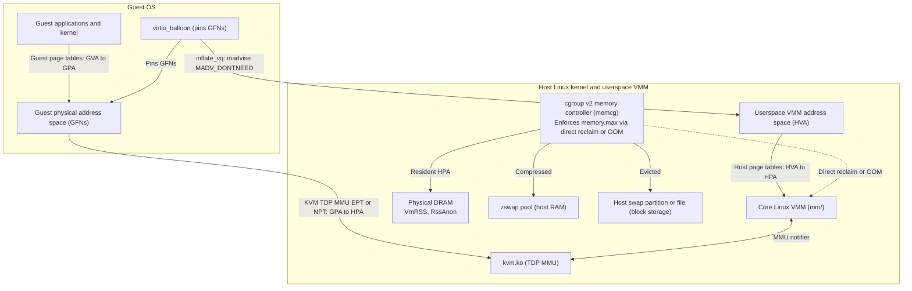
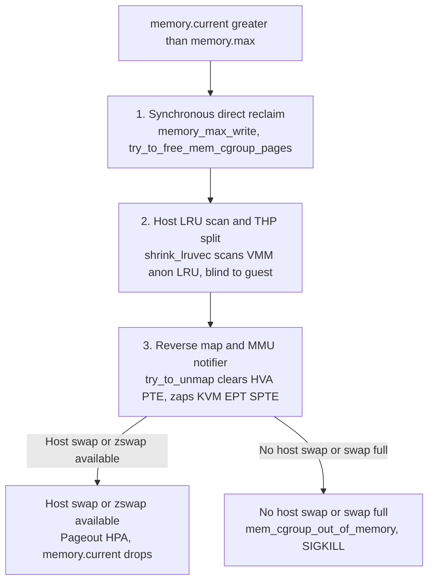

> **NOT DIGESTED.** Kept for a future release. Nothing from this note is in `knowledge/`: Linux KVM is a competitor product, out of scope for release 1.0 (project/plan.md, Not doing; project/knowledge-rules/placement.md). Decision: author, 2026-11-15 (Q-E2-229). Do not write knowledge from it without a new decision.

# Linux KVM Memory Architecture — Ballooning and Limits

## 1. Memory Translation & Accounting Architecture

Unlike ESXi's monolithic hypervisor kernel, Linux implements virtualization by turning the Linux kernel itself into a hypervisor via `kvm.ko`. `kvm.ko` handles CPU execution (`VMX`/`SVM`) and secondary page tables (`TDP MMU` / `EPT` / `NPT`), while delegating physical memory allocation, page replacement, swapping, and cgroup resource limits to the core Linux Virtual Memory Manager (`mm/`).

### Four-Layer Address Translation
1. **Guest Virtual Address (`GVA`):** Virtual address inside the Guest OS.
2. **Guest Physical Address (`GPA` / `GFN`):** Physical address space exposed to the Guest OS, tracked as Guest Frame Numbers (`GFN`).
3. **Host Virtual Address (`HVA`):** Virtual address space (`mm_struct`) of the host userspace VMM process backing the VM. Userspace registers `GPA -> HVA` mappings with `kvm.ko` via `ioctl(vm_fd, KVM_SET_USER_MEMORY_REGION, &region)`.
4. **Host Physical Address (`HPA` / `PFN`):** Actual host DRAM frames mapped to `HVA` by the host Linux kernel page tables (`PGD -> PUD -> PMD -> PTE`).

Synchronization between the core Linux VMM (`HVA -> HPA`) and KVM (`GPA -> HPA`) is enforced by **Linux MMU Notifiers** (`struct mmu_notifier`). Whenever the host kernel unmaps, swaps, or migrates an `HVA`, `kvm_mmu_notifier_invalidate_range_start()` zaps the corresponding `EPT`/`NPT` Shadow Page Table Entry (`SPTE`) in `kvm.ko`.

### Telemetry & Accounting Metrics
Because `kvm.ko` has no monolithic `Consumed` counter, host memory consumption is observed across three kernel interfaces:

* **`VmRSS` & `RssAnon` (`/proc/<pid>/status`):** Resident `HPA` frames mapped into the VMM process's Virtual Memory Areas (`VMAs`). `RssAnon` isolates anonymous guest RAM from file-backed mappings and is the direct equivalent of ESXi's `Consumed` (pre-deduplication).
* **`Pss` (`/proc/<pid>/smaps_rollup`):** Proportional Set Size. Divides pages deduplicated by Kernel Samepage Merging (`ksmd`) across sharing VMs (equivalent to ESXi `Consumed` post-TPS).
* **`Private_Hugetlb` / `Shared_Hugetlb` (`/proc/<pid>/smaps_rollup`):** Tracks `2 MiB` or `1 GiB` explicit HugeTLB mappings, which the kernel excludes from `VmRSS` and `Pss`.
* **`pages_4k`, `pages_2m`, `pages_1g` (`KVM_GET_STATS_FD` / `debugfs`):** Exact count of active `SPTE`s currently populated in KVM's TDP MMU. *(Note: KVM MMU shrinkers or dirty-page logging can zap `SPTE`s without freeing underlying `VmRSS` frames).*
* **`memory.current` (`/sys/fs/cgroup/<vm_slice>/memory.current`):** Total physical memory charged to the VM's `cgroup v2`, equal to `VmRSS` + Host Page Cache + Kernel Overhead (`EPT`/`NPT` page tables allocated with `GFP_KERNEL_ACCOUNT`, host `VmPTE`, and kernel `slab` objects). Equivalent to ESXi `Consumed + Overhead`.

---

## 2. Paravirtualized Memory Ballooning (`virtio_balloon`)

KVM implements guest-cooperative reclamation through the `virtio_balloon` device (`VIRTIO_ID_BALLOON = 5`), operating over standard VirtIO ring buffers (`virtqueues`).

### Components
* **`virtio_balloon.ko` (Guest Kernel Driver):** Manages balloon inflation/deflation workers and communicates via three primary virtqueues: `inflate_vq`, `deflate_vq`, and `stats_vq` (plus `free_page_vq` when Free Page Reporting is negotiated).
* **Userspace VMM Device Backend:** Exposes the VirtIO PCI/MMIO configuration space (`num_pages`, `actual`), processes PFN arrays from the virtqueues, and executes host memory discard syscalls.

### Balloon Inflation Step-by-Step (Reclamation)
1. **Configuration Interrupt:** The host management plane updates `num_pages` (the target number of `4 KiB` pages to reclaim) in the `virtio-balloon` config space and injects a configuration change interrupt into the guest.
2. **Guest Page Allocation (`fill_balloon`):** `virtio_balloon.ko` schedules its workqueue (`update_balloon_size_func`), which invokes `balloon_page_alloc()`. This calls `alloc_page(GFP_HIGHUSER_MOVABLE | __GFP_NOMEMALLOC | __GFP_NORETRY)` in a loop until the target `num_pages` is reached.
   * The Guest OS kernel satisfies these allocations from free lists, drops clean page cache, or swaps cold guest pages to guest swap.
   * Using `__GFP_NORETRY` and `__GFP_NOMEMALLOC` prevents the balloon driver from triggering a Guest OS OOM kill if guest memory is exhausted.
3. **Virtqueue Enqueue:** The driver stores the allocated `struct page` pointers in a `balloon_dev_info` list, writes their `4 KiB` Guest Page Frame Numbers (`GFN`s) into a buffer (up to 256 PFNs per batch), pushes the buffer onto `inflate_vq`, and kicks the queue (`virtqueue_kick()`).
4. **Host Discard (`MADV_DONTNEED`):** The host userspace VMM dequeues the `GFN`s, translates each `GFN -> GPA -> HVA`, and executes `madvise(hva, 4096, MADV_DONTNEED)` (or `fallocate(..., FALLOC_FL_PUNCH_HOLE)` for `memfd`/HugeTLB-backed slots).
5. **Kernel Unmap & MMU Notifier:**
   * `madvise_dontneed()` invokes `zap_page_range_single()`, unmapping the `HVA -> HPA` `PTE`s in the host process page tables.
   * The kernel fires `mmu_notifier_invalidate_range_start()`. Inside `kvm.ko`, `kvm_mmu_notifier_invalidate_range_start()` acquires `kvm->mmu_lock`, zaps the corresponding `SPTE`s in the TDP MMU (`kvm_tdp_mmu_zap_leafs()`), and issues remote TLB flush IPIs (`kvm_flush_remote_tlbs()`).
   * The underlying `HPA` frames are returned to the host buddy allocator (`free_pages()`), dropping `RssAnon` and `memory.current`.

### Balloon Deflation Step-by-Step (Expansion)
1. **Target Reduction:** Host lowers `num_pages` in config space and triggers a config interrupt.
2. **Release to Guest Allocator (`leak_balloon`):** `virtio_balloon.ko` dequeues pages via `balloon_page_dequeue()`, pushes their `GFN`s onto `deflate_vq`, and calls `__free_page()` to return them to the Guest OS buddy allocator.
3. **Demand Paging:** When the Guest OS writes to a deflated `GFN`, an **EPT Violation (`VM Exit`)** enters `kvm_tdp_page_fault()` -> `gfn_to_pfn()`, triggering a host minor page fault (`handle_mm_fault()`) that allocates a fresh zeroed `HPA`.

### Modern Linux Extensions (`free-page-reporting` & `virtio-mem`)
* **Free Page Reporting (`VIRTIO_BALLOON_F_REPORTING`):** Eliminates the need to inflate a balloon for idle VMs. The Guest OS kernel asynchronously reports unallocated pages from its buddy allocator to the host via `free_page_vq`, allowing the host to issue `MADV_DONTNEED` without pinning guest memory.
* **`virtio-mem`:** Addresses ballooning's primary flaw—guest physical memory fragmentation. Instead of pinning scattered `4 KiB` pages, `virtio-mem` dynamically plugs and unplugs contiguous memory blocks (typically `2 MiB` or `4 MiB`) via `requested-size`, preserving Transparent Huge Pages (`THP`) inside both guest and host.

---

## 3. VM Memory Limit (`cgroup v2` `memory.max`)

In Linux, **`kvm.ko` has no awareness of memory limits**. Because a VM executes within a host userspace process context, hard memory caps are enforced by the host kernel's **`cgroup v2` memory controller (`memcg`)** via `/sys/fs/cgroup/<vm_slice>/memory.max`.

### Architectural Decoupling
Unlike ESXi—where setting `sched.mem.max` automatically triggers `vmmemctl` ballooning—**Linux `memcg` (`mm/memcontrol.c`) and `virtio_balloon.ko` are completely decoupled**. Lowering `memory.max` never triggers balloon inflation unless an external userspace orchestrator explicitly commands `virtio_balloon` separately.

### Step-by-Step Reclamation Flow (`memory.current > memory.max`)
When `memory.max` is set below `memory.current` (or when a VM faults in new `HPA`s that breach `memory.max`), the host kernel executes forced direct reclamation without consulting the Guest OS:

1. **Synchronous Direct Reclaim:** Writing a lower byte value to `memory.max` invokes `memory_max_write()` in `mm/memcontrol.c`, entering a synchronous reclaim loop via `try_to_free_mem_cgroup_pages()` to shed the excess bytes immediately.
2. **Host LRU Scanning (`shrink_lruvec`):** The kernel scans the `memcg`'s inactive anonymous LRU list (`isolate_lru_folios()`). If the VM is backed by `2 MiB` Transparent Huge Pages (`THP`), the kernel splits the compound folio into `512` `4 KiB` base pages (`split_huge_page()`). The host kernel has zero visibility into whether a `4 KiB` page holds guest free memory, guest file cache, or active guest kernel structures.
3. **Swap Slot Allocation & Reverse Mapping (`try_to_unmap`):**
   * `shrink_folio_list()` allocates host swap slots (`folio_alloc_swap()`).
   * `try_to_unmap()` walks the `anon_vma` reverse mapping (`rmap`) for each victim `HPA`, clears the host `HVA -> HPA` `PTE` (`ptep_clear_flush()`), and writes a swap entry (`swp_entry_t`).
   * The Linux MMU notifier triggers `kvm_mmu_notifier_invalidate_range_start()` in `kvm.ko`, zapping the leaf `EPT`/`NPT` `SPTE`s and issuing remote TLB flushes (`kvm_flush_remote_tlbs()`).
4. **Pageout (`zswap` / Block Swap):** `pageout()` compresses the dirty guest page into `zswap` (if enabled) or writes it asynchronously to the host swap partition/file. Once writeback completes, the `HPA` frame is freed and `memory.current` drops below `memory.max`.
5. **Hard Failure Mode — OOM Kill (`SIGKILL`):** Unlike ESXi's mandatory `.vswp` file, Linux hosts frequently run with swap disabled (`swapoff -a`) or limited. Because anonymous guest RAM (`RssAnon`) cannot be dropped without swap backing, if swap is absent or exhausted, `try_to_free_mem_cgroup_pages()` fails and the kernel immediately invokes `mem_cgroup_out_of_memory()`, sending **`SIGKILL`** to the VMM process and crashing the VM instantaneously.