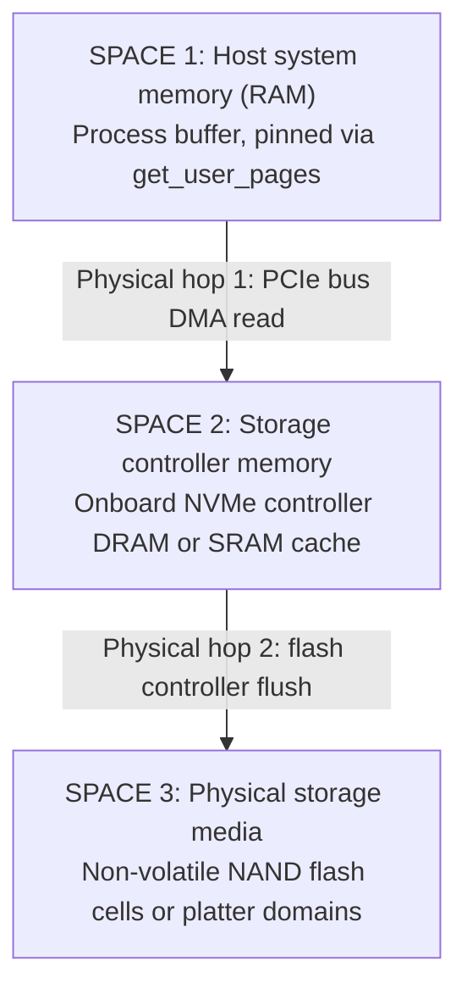
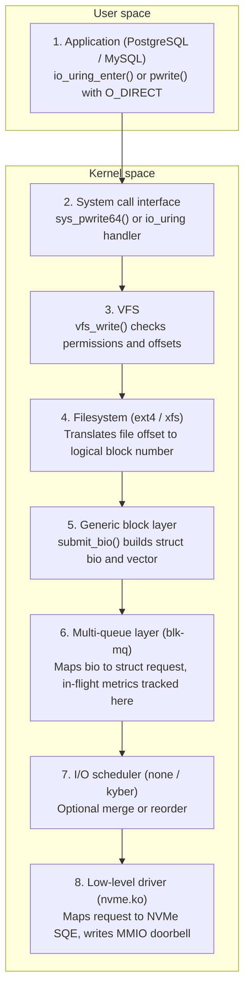
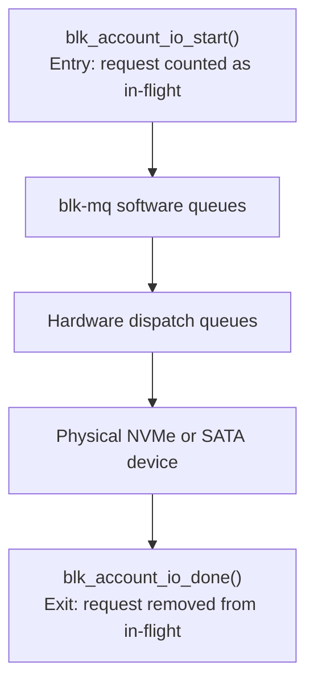

# Linux Storage I/O Subsystem Architecture

Just as in Windows, when an application (such as PostgreSQL or MySQL) issues unbuffered Direct I/O using the `O_DIRECT` flag (or via `io_uring` / `libaio`), the actual **payload data block** (e.g., an $8\text{ KB}$ or $16\text{ KB}$ database block) is physically moved exactly **two times** across hardware boundaries:

1. **Transfer 1 (Host RAM** $\rightarrow$ **Storage Controller Memory):** Initiated via Direct Memory Access (DMA) over the PCIe bus directly from system main memory into the onboard DRAM/SRAM cache of the NVMe or SATA controller.
2. **Transfer 2 (Storage Controller Memory** $\rightarrow$ **Physical Media):** Internal hardware transfer from the storage controller's cache onto physical non-volatile NAND flash cells or magnetic platters.

The complex Linux kernel subsystem—comprising VFS, filesystem layers, `bio` construction, the Multi-Queue Block I/O layer (`blk-mq`), I/O schedulers, and device drivers—operates strictly on the **Control Plane**. Software functions pass pointers, build descriptors, update queue metrics, and issue doorbell rings, but they never copy or transport the underlying data payload bytes.

---

## 2. Fundamental Distinction: Control Plane vs. Data Plane

| Dimension | Control Plane (Kernel Subsystem & Descriptors) | Data Plane (Physical Data Payload) |
| :--- | :--- | :--- |
| **What moves?** | C structures (`struct bio`, `struct request`), page pointers (`struct page*`), Logical Block Addresses (LBAs), scatter-gather lists (`struct scatterlist`), NVMe SQ entries. | The raw application data bytes (e.g., an $8\text{ KB}$ database page). |
| **Execution Space** | Host CPU registers and kernel virtual memory space. | PCIe bus lines, controller DMA engines, controller DRAM, NAND flash array. |
| **Physical Hops** | Traverses 7–10 kernel software modules via inline C function calls. | **2 physical hops** (Host RAM $\rightarrow$ Controller Memory $\rightarrow$ Flash/Media). |
| **Memory Copying** | Zero data payload copying for Direct I/O (`O_DIRECT`). CPU locks pages in RAM via Kernel Page Tables. | Dedicated DMA hardware engine streams bytes asynchronously across the bus. |

---

## 3. Physical Spaces (The Data Plane Path)

There are only **three physical hardware locations** where the data payload exists during an `O_DIRECT` write:

### Space 1: Host System RAM (User Process Memory)
* **Location:** Host DRAM.
* **State:** The database engine allocates an aligned memory buffer containing the payload data. When opening the file with `O_DIRECT`, the kernel calls `pin_user_pages()` / `get_user_pages()` to pin the physical memory pages into RAM. This prevents Linux page reclaim or swap algorithms from moving the physical memory frame while the DMA operation is active.

### Hop 1: PCIe Bus Direct Memory Access (DMA) Transfer
* **Mechanism:** The storage hardware reads the Physical Region Page (PRP) list or Scatter-Gather List (SGL) constructed by the Linux NVMe driver (`nvme.ko`). The controller’s embedded DMA engine pulls data directly across the PCIe bus from host DRAM into controller buffer RAM.
* **CPU Involvement:** $0\%$ host CPU overhead during the byte transfer.

### Space 2: Storage Controller Internal Cache
* **Location:** Onboard SRAM/DRAM on the NVMe drive or Host Bus Adapter (HBA).
* **State:** Data temporarily resides in high-speed device cache while the drive’s Flash Translation Layer (FTL) performs internal address mapping, wear-leveling, and Error Correcting Code (ECC) generation.

### Hop 2: Internal Flash Write
* **Mechanism:** Controller firmware flushes the data payload from device internal cache into non-volatile memory arrays.

### Space 3: Physical Storage Media
* **Location:** NAND flash memory chips (SLC/TLC/QLC) or magnetic disk platters.
* **State:** Permanent, non-volatile state.

---

## 4. Linux Kernel Software Execution Path (The Control Plane)

While the data payload sits undisturbed in host DRAM waiting for hardware DMA, the CPU executes kernel code through the Linux storage stack to prepare command descriptors and manage queues.

### Component Breakdown: Program vs. Space Context

| Step | Software Component | Execution Context / Memory Space | Operation Performed on Command / Metadata |
| :--- | :--- | :--- | :--- |
| **1** | User App (e.g., PostgreSQL) | User Space Virtual Memory | Prepares data in aligned user buffer. Issues syscall (`pwritev2` or `io_uring_enter`) with `O_DIRECT`. |
| **2** | System Call Gateway | Kernel Stack (`sys_pwrite64`) | Switches CPU mode from User (`Ring 3`) to Kernel (`Ring 0`). |
| **3** | VFS Layer (`vfs.ko`) | Kernel Space | Executes `vfs_write()`. Verifies file descriptors, locks, and file offset ranges. |
| **4** | Filesystem (`ext4.ko` / `xfs.ko`) | Kernel Space | Calls `ext4_direct_IO()`. Converts file byte offset into filesystem Logical Block Numbers (LBN). Pins user memory pages into physical RAM. |
| **5** | Generic Block Layer | Kernel Space | Allocates a `struct bio`. Maps memory pages to `bio_vec` array (`struct bio_vec`). Executes `submit_bio()`. |
| **6** | Multi-Queue Layer (`blk-mq`) | Kernel Space | Allocates a `struct request` from the per-CPU software queue (`blk_mq_ctx`). **Increments block layer in-flight metrics (`in_flight`).** |
| **7** | I/O Scheduler (`kyber` / `none`) | Kernel Space | Determines whether to merge adjacent requests or dispatch immediately to the hardware dispatch queue (`blk_mq_hw_ctx`). |
| **8** | Device Driver (`nvme.ko`) | Kernel / MMIO Space | Converts `struct request` into a 64-byte NVMe Submission Queue Entry (SQE). Populates PRP pointers. Writes to the NVMe Controller **Doorbell Register** via MMIO (Memory-Mapped I/O). |

---

## 5. Linux Storage Queue Metrics (`/proc/diskstats` and `iostat`)

On Linux systems, performance utilities such as `iostat`, `sar`, and `prometheus-node-exporter` report disk queue metrics derived directly from kernel statistics exported via `/proc/diskstats` or `/sys/block/<dev>/stat`.

### Where the Metric is Collected

Metrics are tracked at the **Generic Block Layer (`blk-mq`)**, specifically when a request enters `blk_account_io_start()` and completes via `blk_account_io_done()`.

### Key `/proc/diskstats` Counters

The Linux kernel maintains 17 fields per block device in `/proc/diskstats`. Three fields are critical for queue calculation:

* **Field 9 (`in_flight`):** Real-time count of requests currently submitted to the block layer that have not yet completed.
* **Field 10 (`io_ticks`):** Total time (in milliseconds) during which the device had at least one I/O in flight.
* **Field 11 (`time_in_queue`):** Weighted sum of time (in milliseconds) spent by all I/Os in flight.

### Mathematical Derivation of `aqu-sz` (Average Queue Size)

The `iostat` tool calculates **`aqu-sz`** (formerly displayed as **`avgqu-sz`**) over a sampling interval $\Delta t$ (where $\Delta t$ is in seconds) using the accumulated `time_in_queue` delta $\Delta T_{\text{queue}}$ (in milliseconds):

$$
\text{aqu-sz} = \frac{\Delta T_{\text{queue}}}{1000 \times \Delta t}
$$

By **Little's Law**, this formula is functionally equivalent to multiplying the completed I/O throughput ($\text{IOPS}$) by the average response time ($\text{Latency}$):

$$
N_{\text{queue}} = \lambda \times W
$$

Where:
* $N_{\text{queue}}$ is the average queue depth (`aqu-sz`).
* $\lambda$ is the completion rate in IOPS (`r/s + w/s` in `iostat`).
* $W$ is the average duration a request spent in the block stack (`await` in `iostat`, in seconds).

### Software Queue vs. Hardware Queue

Just as in Windows, Linux `aqu-sz` **does not distinguish** between requests waiting in software queues and requests actively processing inside device hardware:

$$\text{aqu-sz} = \text{Requests in } \texttt{blk-mq} \text{ Software Queues} + \text{Requests active in Hardware Submission/Execution Queues}$$

On modern NVMe drives using high queue depths (e.g., 32 parallel hardware queues), an `aqu-sz` of `32` indicates full parallel processing in hardware without any queue starvation or software blocking.
