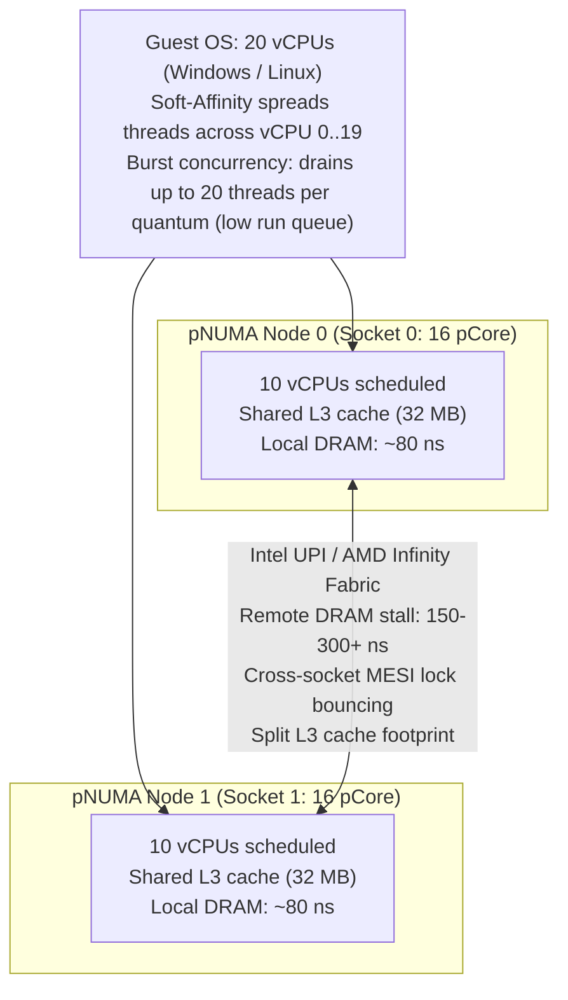
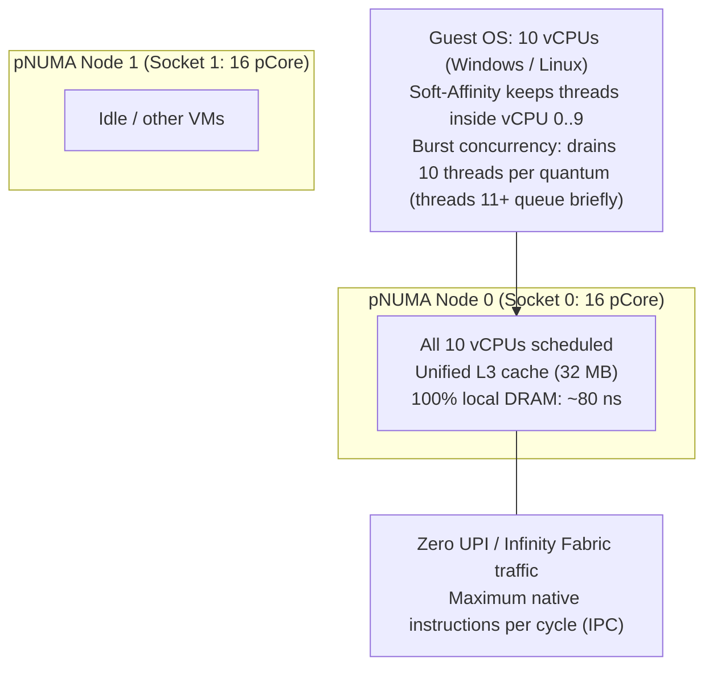

# VM CPU Sizing Best Practices

Right-sizing VM CPU requires balancing two competing architectural forces:

1. **Guest Scheduling Latency (Too Few vCPUs):** Sizing a VM too small forces concurrent runnable threads during millisecond micro-bursts to wait in the Guest OS Run Queue. This is an **intermittent tax** paid only during burst peaks.
2. **NUMA & Coherency Degradation (Too Many vCPUs):** Sizing a VM wider than a single physical NUMA (pNUMA) node splits execution across CPU sockets. Remote memory access, split Last-Level Cache (L3), and cross-socket cache-line bouncing impose a **continuous tax** on every memory-bound instruction cycle.

Always size a VM to fit within a **single physical NUMA node** first (for example, scaling up to 10, 12, or 16 vCPUs on a 16-core socket) before crossing a NUMA boundary to 20+ vCPUs. A single-NUMA VM absorbing moderate micro-burst queuing consistently outperforms a wide VM suffering continuous remote memory stalls.

---

## Sample Scenario: 10 vCPU vs. 20 vCPU

Consider a simple hypervisor host with **16 physical cores (pCores) per NUMA boundary** (two 16-core pNUMA nodes, 32 pCores total). An enterprise workload requires **7.0 cores of average compute** over a 300-second window and exhibits sub-second micro-bursts:

* **Option A (20 vCPUs @ 35% Average Run):** Delivers $20 \times 0.35 = 7.0$ active cores. Exceeds the 16-core pNUMA boundary, forcing the hypervisor to split the VM across Socket 0 and Socket 1.
* **Option B (10 vCPUs @ 70% Average Run):** Delivers $10 \times 0.70 = 7.0$ active cores. Fits entirely inside Socket 0's 16-core pNUMA node with 100% local memory access.

### Architectural Topology Comparison

#### Option A: 20 vCPU VM (spans 2 pNUMA nodes, continuous inter-socket tax)

#### Option B: 10 vCPU VM (fits 1 pNUMA node, zero inter-socket tax)

---

## Three Sizing Forces

### Micro-Bursting and Telemetry Aliasing
Modern event-driven applications (JVM, .NET, NGINX, SQL engines) do not consume CPU smoothly. Interrupt coalescing, network packet batching (GRO/RSS), and mutex/futex releases wake dozens of sleeping threads within microseconds ($\mu\text{s}$) to execute for $1\text{ ms}$ to $50\text{ ms}$ before blocking again.

* **Why Average CPU Utilization Fails:** A $50\text{ ms}$ spike at $100\%$ CPU inside a $20,000\text{ ms}$ ($20\text{ s}$) polling interval adds only $0.25\%$ to the reported average. A VM showing $35\%$ or $70\%$ average utilization can be hitting $100\%$ micro-saturation every second.
* **Run Queue Reveals Bursts:**
  * **Windows (`System\Processor Queue Length`):** Samples instantaneous threads in the **Ready** state (excluding currently running threads). A burst of 18 threads produces a queue of `0` on a 20 vCPU VM and `8` on a 10 vCPU VM.
  * **Linux (`procs_running` / `vmstat` `r`):** Counts all `TASK_RUNNING` threads (**Running + Ready**). A burst of 18 threads reports `18` on both VMs, meaning `0` waiting on 20 vCPUs and `8` waiting on 10 vCPUs.

### OS Soft-Affinity and Cache Locality
Both Windows and Linux use **soft-affinity** by default to maximize L1/L2/L3 cache hit rates:

* **Linux (EEVDF / CFS):** Uses `wake_affine()` and cache-hot heuristics to schedule waking tasks back onto their previous runqueue (`struct rq`).
* **Windows (Dispatcher):** Assigns each thread an **Ideal Processor** (`KPRCB`) and biases scheduling toward the last logical processor where the thread ran.

**Sizing Impact:**
* Within a **single pNUMA node (10 vCPUs)**, soft-affinity keeps threads warm in private L1/L2 caches, and even if the scheduler load-balances a thread to an adjacent vCPU during a burst, both cores share the **same physical L3 cache** (~15–40 ns cache-to-cache transfer).
* Across **two pNUMA nodes (20 vCPUs)**, load-balancing a thread from vCPU 2 (Socket 0) to vCPU 14 (Socket 1) invalidates its L1/L2/L3 cache footprint and forces subsequent memory reads across the inter-socket fabric.

### NUMA Penalties
When a VM exceeds one pNUMA node (e.g., 20 vCPUs on a 16-core socket), three continuous penalties degrade CPU execution efficiency (IPC):

1. **Remote Memory Latency:** Accessing DRAM attached to the remote socket's Integrated Memory Controller (IMC) traverses Intel UPI or AMD Infinity Fabric, increasing latency from ~80 ns to **150–300+ ns** ($1.5\times$ to $3\times$ slower).
2. **Cross-Socket Coherency Traffic:** Shared locks, futexes, and atomic operations (`LOCK CMPXCHG`) bounce cache lines between Socket 0 and Socket 1 via MESI/MOESI snoops, stalling CPU store buffers.
3. **The CPU Hot-Add Trap (`vcpu.hotadd = TRUE`):** Enabling CPU Hot-Add in VMware vSphere **disables vNUMA** and exposes a single flat UMA topology to the Guest OS. Windows and Linux then allocate memory and schedule threads blindly across both sockets, maximizing remote memory misses.

---

## Sizing Decision Matrix

Use **20-second Run Queue telemetry**, **VM contention (`%RDY` / `%CSTP`)**, and **host pNUMA size** together to select the right vCPU count:

| Workload & Telemetry Profile | Recommended Size | Engineering Rationale |
| :--- | :--- | :--- |
| **20s Run Queue stays $\le 10$ runnable threads** (Low burst concurrency) | **10 vCPUs** (Single pNUMA) | All bursts execute with zero guest queuing. Eliminates extra `vmm` scheduling overhead and guarantees 100% local NUMA memory. |
| **20s Run Queue bursts to $11\text{--}25$ threads; monolithic heap / DB / shared locks** | **10 to 16 vCPUs** (Max 1 pNUMA) | Intermittent queuing during bursts is far cheaper than continuous cross-socket remote DRAM and lock-bouncing stalls. Scale up to the single-socket ceiling (e.g., 14 or 16 vCPUs) before ever crossing sockets. |
| **High VM `CPU Ready` ($> 5\%$) or `Co-Stop` ($> 3\%$)** | **10 vCPUs** (Smaller footprint) | Wide VMs suffer hypervisor co-scheduling delays on contended hosts. Reducing vCPU count lowers `%RDY` and drains guest queues faster. |
| **20s Run Queue bursts $> 25$ threads; stateless / NUMA-partitioned workers** | **20 vCPUs** (Dual pNUMA) | Only beneficial when worker threads share minimal mutable state (e.g., stateless proxies, batch rendering) and eliminating burst queue latency outweighs remote DRAM cost. |

---

## Step-by-Step Sizing Playbook

### Step 1: Identify the Host pNUMA Ceiling
Never size a VM in isolation from the underlying physical cluster hardware.
* Determine the smallest physical socket core count across all ESXi hosts in the cluster (e.g., 16 pCores per NUMA boundary).
* Set **16 vCPUs** (or 14–15 vCPUs to leave headroom for hypervisor interrupts) as your hard single-NUMA ceiling.

### Step 2: Eliminate Artificial NUMA Blockers
* **Disable CPU Hot-Add** (`vcpu.hotadd = FALSE`) on any VM with more than 8 vCPUs so the hypervisor exposes accurate vNUMA topology to the Guest OS.
* Configure **Cores per Socket** to match physical hardware boundaries (in vSphere 8+, leave `Cores per Socket` at default auto-assignment unless licensing dictates otherwise).

### Step 3: Measure True Burst Concurrency (Ignore 5-Minute Averages)
* Collect **20-second real-time intervals** (not 5-minute or 1-hour rollups).
* Calculate peak runnable concurrency:
  * **Windows:** `Peak Concurrency = Active vCPUs + System\Processor Queue Length`
  * **Linux:** `Peak Concurrency = procs_running` (`vmstat` `r` column)
* If `Peak Concurrency` rarely exceeds 10–16 threads, keep the VM inside a single pNUMA node.

### Step 4: Scale Up Inside the Socket Before Crossing Sockets
If a **10 vCPU** VM shows elevated tail latency ($p99$) correlated with 20-second Run Queue spikes:
1. First scale to **12, 14, or 16 vCPUs** (staying inside the single 16-core pNUMA node).
2. Cross to **20 vCPUs** only after exhausting single-socket capacity **and** verifying that application memory/locking patterns tolerate cross-socket latency.

---

## Post-Resize Verification

After resizing or deploying a VM, validate both queuing and NUMA locality using the following counters:

| Platform | Tool / Counter | Healthy Target | Red Flag Threshold & Action |
| :--- | :--- | :--- | :--- |
| **ESXi Host** | `esxtop` (`m` view) $\rightarrow$ `N%L` (NUMA Local %) | **$> 90\%$** | **$< 85\%$:** VM is thrashing remote DRAM. Downsize vCPUs to fit 1 pNUMA node or disable CPU Hot-Add. |
| **Linux Guest** | `numastat -p <pid>` & `vmstat 1` (`r`) | Low `numa_miss`; `r <= 1.5x vCPUs` | High `numa_miss`: Pin workers with `numactl` or downsize VM into a single pNUMA node. |
| **Windows Guest** | PerfMon: `Processor Queue Length` & `NUMA Node Memory\Remote Node Memory` | Queue `< 2–3` per vCPU; minimal remote memory | Sustained queue $> 10$ per vCPU with low remote memory: Add vCPUs up to the single-socket pNUMA limit. |