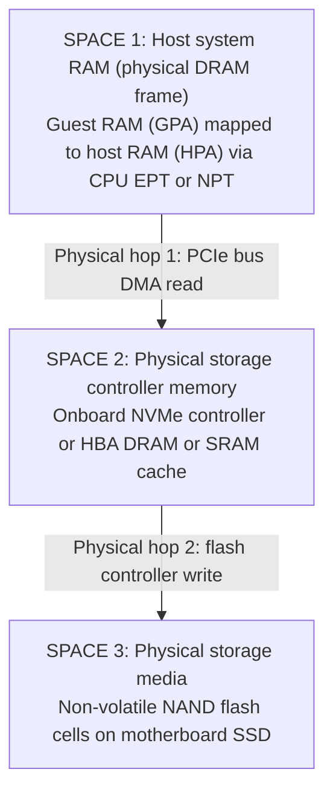
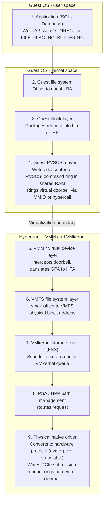
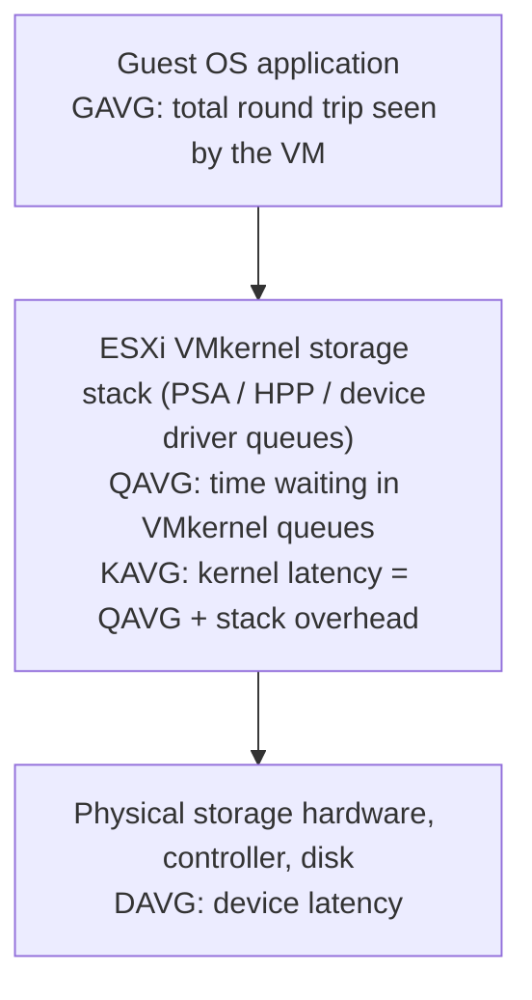

# VMware ESXi Storage Subsystem Architecture

When a virtualized workload (running inside a Guest OS such as Windows or Linux) issues an unbuffered Direct I/O write to a virtual disk (`.vmdk`) backed by a local VMFS datastore on a physical motherboard-attached SSD, the **payload data block** still moves physically **exactly two times** across hardware boundaries:

1. **Transfer 1 (Host Physical RAM** $\rightarrow$ **Storage Controller Memory):** Initiated via Direct Memory Access (DMA) over the host PCIe bus directly from host RAM into the onboard SRAM/DRAM cache of the physical SSD/NVMe controller.
2. **Transfer 2 (Storage Controller Memory** $\rightarrow$ **Physical Flash Media):** Internal hardware write execution from device controller cache onto physical NAND flash cells.

### Why Virtualization Does Not Add Extra Payload Data Copies
x86 hardware virtualization utilizes **Extended Page Tables (EPT) / Nested Page Tables (NPT)**. Memory allocated by the Guest OS (Guest Physical Address or GPA) maps directly to actual Host Physical Addresses (HPA) in physical DRAM. 

When the Paravirtualized SCSI (`PVSCSI`) device driver inside the Guest OS submits an I/O request, the VMkernel translates the descriptor’s memory addresses from GPA to HPA. The physical storage controller’s DMA engine then reads data **directly** out of host DRAM (which is the exact physical location holding the guest memory page). The hypervisor does **not** copy the payload bytes into a secondary host buffer.

The virtualization layers added by VMware ESXi—including the PVSCSI virtual device emulation, VMM ring buffers, Virtual Machine File System (`VMFS`), Pluggable Storage Architecture (`PSA`), and ESXi native drivers—operate entirely within the **Control Plane**.

---

## 2. Fundamental Distinction: Control Plane vs. Data Plane in ESXi

| Dimension | Control Plane (Virtualization & Metadata) | Data Plane (Physical Data Payload) |
| :--- | :--- | :--- |
| **What moves?** | Command descriptors, SCSI CDBs, PVSCSI Ring Descriptors, File-to-LUN block maps, I/O requests (`scsi_cmnd`). | The raw application data bytes (e.g., $8\text{ KB}$ database page). |
| **Execution Space** | Guest Kernel, VMM (Virtual Machine Monitor), VMkernel address space (`esx-base`). | Host PCIe bus, Host DRAM (HPA), physical SSD controller cache, NAND flash chips. |
| **Physical Hops** | Traverses Guest OS stack $\rightarrow$ PVSCSI device emulation $\rightarrow$ VMkernel Storage Stack $\rightarrow$ Physical HBA driver. | **2 physical hops** (Host RAM $\rightarrow$ Controller SRAM/DRAM $\rightarrow$ Flash Cells). |
| **Payload Copying** | Zero payload data copying. VMkernel rewrites address descriptors from GPA to HPA. | Hardware DMA engine streams payload bytes across the physical PCIe bus without CPU involvement. |

---

## 3. Physical Spaces & Hardware Memory Mapping

Despite passing through a virtualized environment, there are only **three physical hardware locations** where the data payload resides.

### Memory Address Translation (GPA to HPA)
1. **User Application (Guest OS):** Allocates memory buffer at Virtual Memory Address (GVA).
2. **Guest Kernel:** Maps GVA to Guest Physical Address (GPA) and pins the page frame.
3. **VMkernel / PVSCSI Emulation:** Translates GPA to Host Physical Address (HPA) using hardware-assisted memory virtualization (Intel EPT or AMD NPT).
4. **Physical HBA Driver:** Constructs hardware Scatter-Gather List (SGL) containing the translated HPA pointers.
5. **Physical DMA Engine:** Fetches data directly from the physical DRAM location corresponding to HPA.

---

## 4. End-to-End Control Plane Traversal

This section traces a single SCSI write command from an application inside a VM down to the physical SSD.

### Component Breakdown: Program vs. Memory Context

| Step | Component / Layer | Context / Space | Operation Performed on Command Descriptor |
| :--- | :--- | :--- | :--- |
| **1** | User Application | Guest User Space | Prepares data block in memory; calls system write API (`FILE_FLAG_NO_BUFFERING` / `O_DIRECT`). |
| **2** | Guest Filesystem | Guest Kernel Space | Translates file byte offset to Guest Logical Block Address (Guest LBA). |
| **3** | Guest PVSCSI Driver | Guest Kernel Space | Formats request into a SCSI command descriptor; writes to **PVSCSI Request Ring** (shared memory buffer). Writes to PVSCSI MMIO register. |
| **4** | Virtual Machine Monitor (VMM) | Hypervisor / VMM Context | Intercepts MMIO access; pulls descriptor from ring buffer; translates Guest Physical Address (GPA) pointers to Host Physical Address (HPA). |
| **5** | VMFS Filesystem (`vmfs.ko`) | VMkernel Execution Space | Maps `.vmdk` block offset to VMFS Datastore Logical Unit (LUN) block offset. Handles extent locking if allocation is dynamic. |
| **6** | File System Switch (FSS) | VMkernel Execution Space | Coordinates virtual disk file handles and passes command to the VMkernel Storage Core. |
| **7** | PSA / HPP Engine | VMkernel Execution Space | Routes I/O through **Pluggable Storage Architecture (PSA)** or **High Performance Plug-in (HPP)** for path optimization and queue depth checks. |
| **8** | Native Device Driver | VMkernel Driver Space | Translates VMkernel SCSI command into native storage controller format (e.g., `nvme-pcie`). Writes entry to physical controller Submission Queue. |
| **9** | Physical Storage Controller | Physical Hardware | Executes MMIO Doorbell write. Hardware DMA engine pulls payload data directly from physical RAM (HPA). |

---

## 5. ESXi Storage Queue Metrics (`esxtop` Analysis)

In a virtualized ESXi environment, storage queue statistics are monitored using **`esxtop`** (Storage View: `d` for disk adapters, `u` for LUNs, `v` for VMs). 

Unlike bare-metal operating systems which measure queue depth at a single driver boundary, ESXi breaks down latency and queuing across **four distinct layers**:

### Key Latency & Queue Formulas in `esxtop`

$$
\text{GAVG} = \text{KAVG} + \text{DAVG}
$$

$$
\text{KAVG} = \text{QAVG} + \text{VMkernel Processing Latency}
$$

| Metric | Full Name | Location Tracked | What It Actually Measures |
| :--- | :--- | :--- | :--- |
| **`DAVG`** | Device Average Latency | Physical Hardware / HBA | Time (ms) elapsed from when ESXi submits a command to the physical controller until the controller returns execution completion. Represents pure hardware response time. |
| **`QAVG`** | Queue Average Latency | VMkernel Scheduler Queue | Time (ms) spent by an I/O request waiting in VMkernel software queues because hardware or device queue depth limits (`LUN Queue Depth`) have been reached. |
| **`KAVG`** | Kernel Average Latency | VMkernel Storage Stack | Total time (ms) an I/O spends inside the hypervisor stack (`KAVG` = `QAVG` + stack execution overhead). Should ideally be $< 1\text{ ms}$. |
| **`GAVG`** | Guest Average Latency | Guest OS / Virtual Device | Total round-trip latency (ms) experienced by the Virtual Machine. |

### Diagnostic Rule of Thumb for Storage Performance

* **High `DAVG` ($> 10\text{–}15\text{ ms}$), Low `KAVG`:** The physical storage drive or hardware controller is saturated or experiencing physical bottlenecks.
* **High `KAVG` / `QAVG` ($> 2\text{–}5\text{ ms}$), Low `DAVG`:** The hypervisor software queues are throttling requests. This usually occurs when the VM’s concurrent requests exceed configured device queue depths (e.g., `pvscsi` queue depth or `Disk.SchedNumReqOutstanding`).

