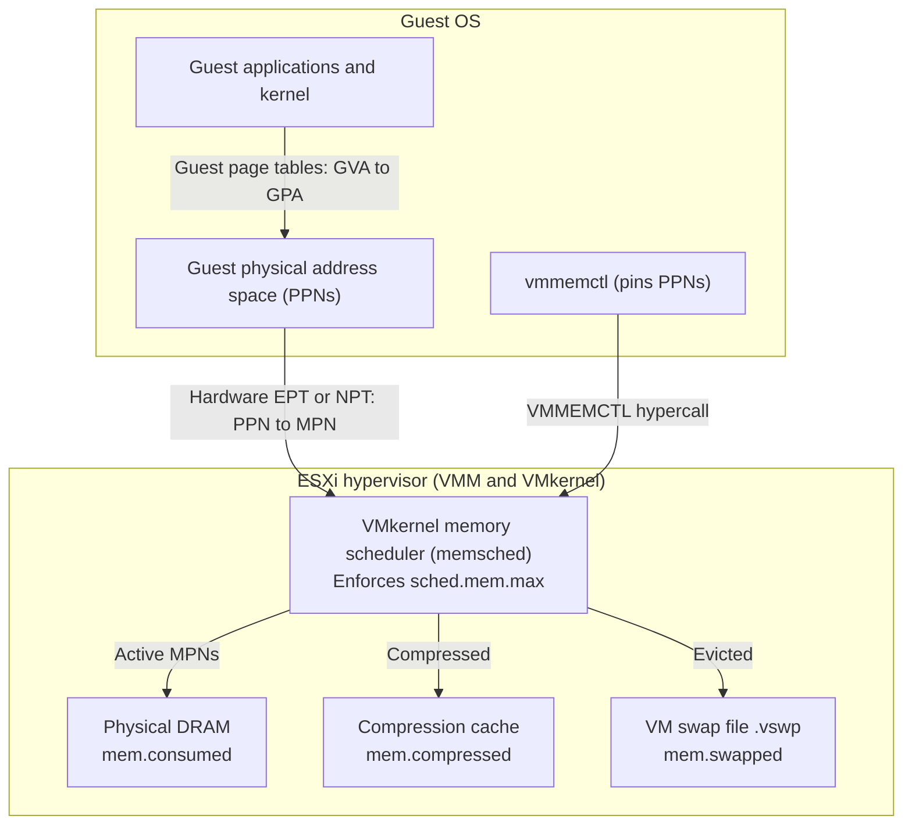
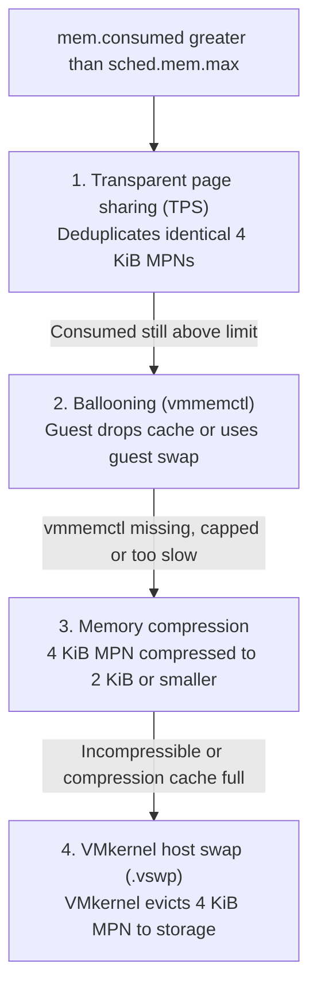

# VMware ESXi Memory Architecture — Ballooning and Limits

## 1. Memory Translation & Accounting Architecture

ESXi manages three distinct memory address spaces for every running Virtual Machine:

1. **Guest Virtual Address (`GVA`):** Virtual memory managed by the Guest OS kernel and its applications.
2. **Guest Physical Address (`GPA` / `PPN`):** Contiguous physical address space presented to the Guest OS as virtual DIMMs, tracked in units of Physical Page Numbers (`PPN`).
3. **Host Machine Address (`HMA` / `MPN`):** Actual physical DRAM frames installed on the ESXi host, tracked by VMkernel as Machine Page Numbers (`MPN`).

Hardware-assisted Memory Management Units (Intel Extended Page Tables `EPT` / AMD Nested Page Tables `NPT`) translate `GPA -> HMA` directly in silicon, while VMkernel maintains parallel `pmap` metadata structures to track page ownership, sharing, and reclamation state.

### Telemetry & Accounting Metrics
VMkernel separates a VM's physical host memory footprint into two non-overlapping categories:

* **`mem.consumed` (Consumed Memory):** Total `MPN`s mapped exclusively to back the VM's `GPA` space (`PPN -> MPN`), post-Transparent Page Sharing (TPS) deduplication.
* **`mem.overhead` (Overhead Memory):** Extra `MPN`s allocated by VMkernel and the VMM/VMX outside the `GPA` space to virtualize the VM. This includes `EPT`/`NPT` page tables, VMM runtime structures, the VMX userspace process, and virtual SVGA framebuffers.
* **Total Host Footprint:** $\text{Total MPN Footprint} = \text{mem.consumed} + \text{mem.overhead}$.

---

## 2. Paravirtualized Memory Ballooning (`vmmemctl`)

Memory ballooning allows VMkernel to reclaim physical `MPN`s from a VM by delegating victim page selection to the Guest OS kernel, which possesses full visibility into free lists, clean file-system caches, and process working sets.

### Components
* **`memsched` (VMkernel):** Calculates per-VM memory targets based on shares, reservations, limits, and host free memory thresholds (`High`, `Soft`, `Hard`, `Low`).
* **`vmmemctl` (Guest Kernel Driver):** Deployed via VMware Tools (`vmw_balloon.ko` on Linux; `vmmemctl.sys` on Windows). Communicates with the VMM via the VMware backdoor hypercall interface (`VMMEMCTL_HYPERCALL`).
* **Balloon Ceiling (`sched.mem.maxmemctl`):** Defaults to **65%** of configured VM memory to prevent the balloon driver from starving the Guest OS kernel of non-pageable pool memory. VMkernel dynamically lowers this ceiling if guest telemetry indicates low available guest memory.

### Balloon Inflation Step-by-Step (Reclamation)
1. **Target Assignment:** `memsched` sets a non-zero target (`mem.vmmemctltarget`) in the VMM control block.
2. **Hypercall Poll:** On its periodic timer (typically 1-second intervals), `vmmemctl` polls the VMM and detects `current_size < target_size`.
3. **Guest Page Allocation:** `vmmemctl` requests `4 KiB` frames from the Guest OS physical page allocator (`alloc_page()` with `__GFP_HIGHMEM` on Linux; `MmAllocatePagesForMdlEx()` on Windows).
   * If the Guest OS has unallocated free pages, they are handed over immediately.
   * If free pages are exhausted, the Guest OS kernel invokes its native page-replacement algorithm: dropping clean page cache entries first, then swapping cold anonymous pages to the **guest swap device (`pagefile.sys` / swap partition)**.
4. **Pinning & Notification:** `vmmemctl` locks the allocated `PPN`s in a driver-owned list so the Guest OS cannot reuse them, and passes an array of `PPN`s to the VMM via hypercall.
5. **EPT/NPT Unmapping:** The VMM invalidates the leaf `EPT`/`NPT` entries for those `PPN`s, updates `pmap`, and releases the backing `MPN`s back to the VMkernel free pool. `mem.consumed` decreases immediately.

### Balloon Deflation Step-by-Step (Expansion)
1. **Target Reduction:** When memory pressure subsides or the limit is raised, `memsched` lowers `mem.vmmemctltarget`.
2. **Release to Guest Allocator:** `vmmemctl` unpins the `PPN`s from its internal list and frees them back to the Guest OS page allocator (`__free_page()` / `MmFreePagesFromMdl()`).
3. **Demand Paging:** No `MPN`s are allocated during deflation. When the Guest OS later writes to a released `PPN`, the CPU triggers an **EPT Violation (`VM Exit`)**, and the VMM faults in a new zero-filled `MPN` on demand.

---

## 3. VM Memory Limit (`sched.mem.max`)

A VM Memory Limit (`sched.mem.max`) enforces a hard ceiling on `mem.consumed` (it does not restrict `mem.overhead`, which is separately bounded by `sched.mem.overheadMax`).

### Architectural Behavior
Unlike shares or reservations—which only take effect during host contention—**a limit is enforced unconditionally**, even when the ESXi host has abundant unallocated physical RAM.

### Step-by-Step Reclamation Flow (`Consumed > Limit`)
When `sched.mem.max` is lowered below current `mem.consumed` (or when a VM grows toward its limit), VMkernel executes a strict, multi-stage reclamation hierarchy:

1. **Stage 1 — Transparent Page Sharing (TPS):** VMkernel hashes `4 KiB` `MPN`s (salted intra-VM by default) and collapses identical pages into a single Copy-on-Write (`CoW`) `MPN`.
2. **Stage 2 — Balloon Inflation (`vmmemctl`):** `memsched` sets `mem.vmmemctltarget` equal to the reclamation deficit (`Consumed - Limit`). If `vmmemctl` is installed and responsive, the Guest OS sheds cold pages cleanly.
3. **Stage 3 — VMkernel Memory Compression (`mem.compressed`):** If `vmmemctl` is absent, disabled, hits `sched.mem.maxmemctl`, or cannot inflate fast enough, VMkernel selects victim `PPN -> MPN` mappings without guest consent. It compresses `4 KiB` pages (using LZ4/WKdm) into blocks of `2 KiB` or smaller and stores them in a per-VM compression cache in host DRAM. Packing two `4 KiB` guest pages into one `4 KiB` `MPN` reduces `mem.consumed` while keeping decompression latency in the microsecond range.
4. **Stage 4 — VMkernel Host Swap (`mem.swapped`):** For incompressible pages or remaining deficit:
   * The VMM executes TLB shootdowns across the VM's vCPUs and invalidates the leaf `EPT`/`NPT` entries for the victim `PPN`s.
   * VMkernel writes the raw `4 KiB` contents of those `MPN`s directly to the VM's `.vswp` file on storage (or host NVMe/SSD swap cache) and frees the `MPN`s.

### Runtime Penalty: Double Paging
When VMkernel swaps out an `MPN` via Stage 4, the Guest OS remains unaware and still considers that `GPA` resident in fast RAM.
* **Synchronous Stall:** Any guest instruction accessing that `GPA` triggers an **EPT Violation (`VM Exit`)**, halting the vCPU thread synchronously while VMkernel reads the `4 KiB` page from `.vswp` into an `MPN` (evicting another `MPN` to stay below `sched.mem.max`).
* **Double Paging:** If the Guest OS later experiences internal memory pressure and decides to page out that same `GPA` to its own guest swap file, VMkernel must first read the page in from `.vswp` into host DRAM only for the Guest OS to immediately write it back out to guest storage—amplifying storage IOPS and latency.