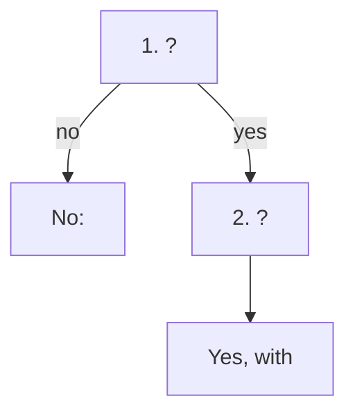

# <The operational question, as users ask it>

## Question
- <The question: can it, should it, how much; on which object.>
- The answer is <the choice to act: yes or no, a size, a date>, with <the limiting resource or the evidence> and the reason.
- An operational question, answered by a decision tree; not a health check. <If an object health check reads its result: name the health check and its step.>

## Flow


## Checks, in order
1. <Metric, KPI or model> (<object>). <Threshold, with source> → step 2. Otherwise → no: <reason>.
2. <Next check> (<object>). <Band> → <answer>.

## Why this order
- <Reason for each step's position: what an earlier step rules out.>

## How to read the result
- <Where the tree stopped> → <what the answer means and what to do>.

## Traps
- Wrong conclusion → correct conclusion.

## Metadata
```yaml
id: vsphere/object-types/<object>/decision-tree/<slug>   # one technology: vsphere/technology/<tech>/decision-tree/<slug>
retriever_guide: decision-tree
scope: vsphere
technology: [cpu, memory]
pillar: [capacity]
product: [vsphere, vcf-operations]
object: [<ManagedObjectType>]
internal_derive: []                # KPI, model and metric ids the steps name
related: [sp5-framework/concepts/health-check]
source:
  document: <document name, version, revision>
  path: <heading path and pages>
corrections: []
review_notes: []
status: draft
```
