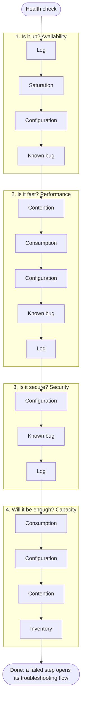

# <Object>: health check

## Purpose
- A scheduled or on-demand check of one object across every pillar: is it healthy, at risk, or wasteful? The what, not the why. What a health check is: `sp5-framework/concepts/health-check`.

## Flow


## Checks, in order
Order (author, 2026-11-09): four questions, and within each the what (facts) before the why (explanation):
- Is it up? Availability: log, saturation, configuration, known bug. A system that is down has no performance problem and cannot be attacked.
- Is it fast? Performance: contention, consumption, configuration, known bug, log. Up does not mean fast.
- Is it secure? Security: configuration, known bug, log. Running well does not mean safe from attack.
- Will it be enough? Capacity: consumption, configuration, contention, inventory. A healthy present does not mean a healthy future. Efficiency (waste) is read here.
1. Availability. <What is checked, or: future, after 1.0.> → step 2.
2. Performance: <KPI> (<object>). Green → step 3. Otherwise → `<troubleshooting id>`.
3. Capacity: <model> (<object>). <Band, with source> → step 4.
4. Configuration: `<configuration review id>`. Also the drill-down when step 1 or 2 failed: configuration can cause both.
5. Efficiency: <waste check>.
- Not checked in 1.0: security and compliance (future phase).

## Why this order
- Availability first: a system that is down has no performance problem. Then performance, then risk, then efficiency.

## How to read the result
- Present health, risk and efficiency are read separately, never as one score.

## Traps
- Wrong conclusion → correct conclusion.

## Metadata
```yaml
id: vsphere/object-types/<object>/health-check/<object>-health-check
retriever_guide: health-check
scope: vsphere
technology: [cpu, memory, storage, network]
pillar: [availability, performance, capacity]
product: [vsphere, vcf-operations]
object: [<ManagedObjectType>]
internal_derive: []                # KPI, model and flow ids the steps name
related: [sp5-framework/concepts/health-check]
source:
  document: <document name, version, revision>
  path: <heading path and pages>
corrections: []
review_notes: []
status: draft
```
