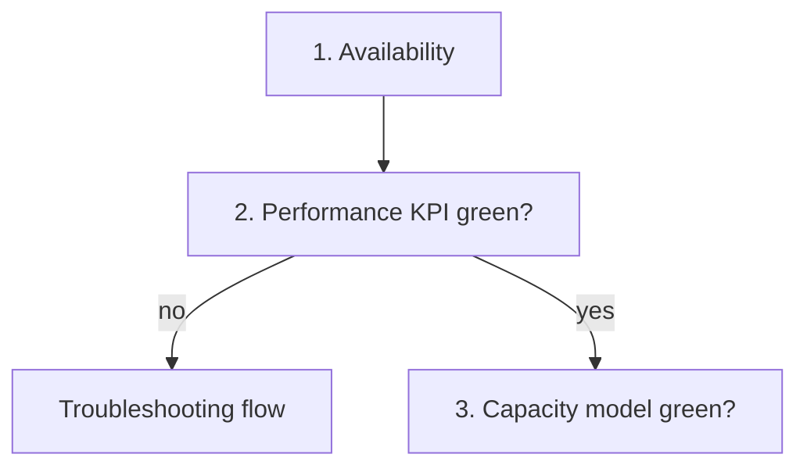

# <Object>: health check

## Symptom
- None. A scheduled or on-demand check of one object: is it healthy, at risk, or wasteful? The what, not the why.

## Flow


## Checks, in order
Order (author, Q104 and Q133, 2026-11-09): availability, performance, security, capacity. Configuration is checked as the drill-down under each of the four, because a setting can affect all of them. Efficiency (waste) is read as part of capacity.
1. Availability. <What is checked, or: future, after 1.0.> → step 2.
2. Performance: <KPI> (<object>). Green → step 3. Otherwise → `<troubleshooting id>`.
3. Capacity: <model> (<object>). <Band, with source> → step 4.
4. Configuration: `<configuration review id>`. Also the drill-down when step 1 or 2 failed: configuration can cause both.
5. Efficiency: <waste check>.
- Not checked in 1.0: security and compliance (future phase).

## Why this order
- Availability first: a system that is down has no performance problem. Then performance, then risk, then efficiency.

## How to read the result
- Present health, risk and efficiency are read separately, never as one score.

## Traps
- Wrong conclusion → correct conclusion.

## Metadata
```yaml
id: vsphere/object-types/<object>/health-check/<object>-health-check
retriever_guide: health-check
scope: vsphere
technology: [cpu, memory, storage, network]
pillar: [availability, performance, capacity]
product: [vsphere, vcf-operations]
object: [<ManagedObjectType>]
internal_derive: []                # KPI, model and flow ids the steps name
related: []
source:
  document: <document name, version, revision>
  path: <heading path and pages>
corrections: []
review_notes: []
status: draft
```
