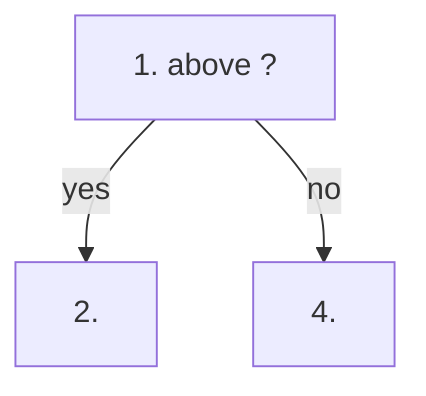

# <Symptom or question: why the object failed a health check>

## Symptom
- What is observed, on which object. Which health check step failed, or the user complaint (a complaint is a failed health check).

## Flow



## Checks, in order
1. <Metric> (<object>). <Threshold, with source> → step 2. Otherwise → step 4.
2. Contention metrics first, then configuration (always, author Q104), then consumption, then context.

## Why this order
- <Reason for each step's position.>

## How to read the result
- Value pattern → meaning → next check.

## Traps
- Wrong conclusion → correct conclusion.

## Metadata
```yaml
id: vsphere/technology/<technology>/troubleshooting/<slug>
retriever_guide: troubleshooting
scope: vsphere
technology: [cpu]
pillar: [performance]
product: [vsphere]
object: [VirtualMachine]
internal_derive: []                # ids of concept and metric files the checks rely on
related: []
images:  # one entry per image linked in the body; omit when none
  - path: ../../images/<name>.png
    product: [vsphere]
    object: [VirtualMachine]
    metric: ['<metric name>']   # and/or topic: '<concept>'
    image_type: timeline         # diagram, table, timeline, distribution, scatter, screenshot
    sample: '<optional: fleet size and period>'
source:
  document: <document name, version, revision>
  path: <heading path and pages>
corrections: []
review_notes: []
status: draft
```
